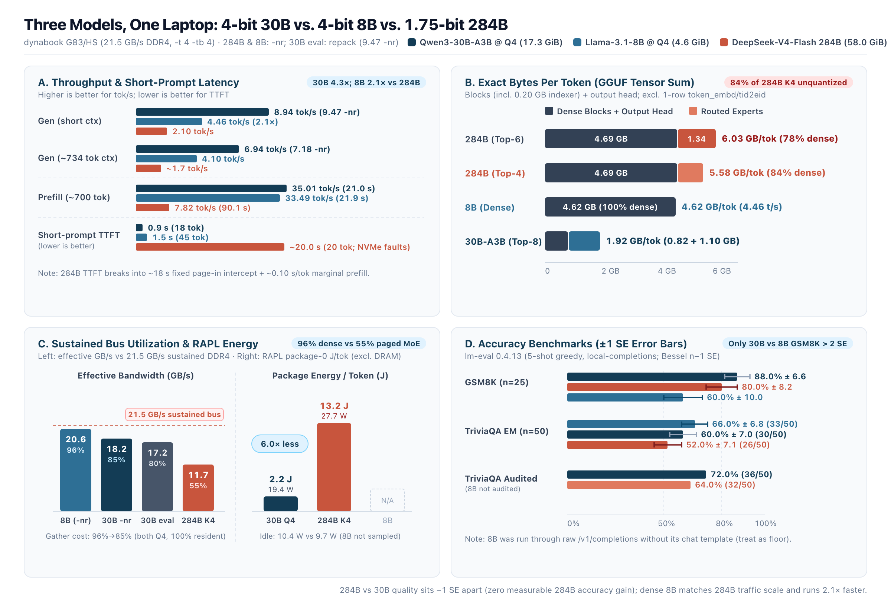
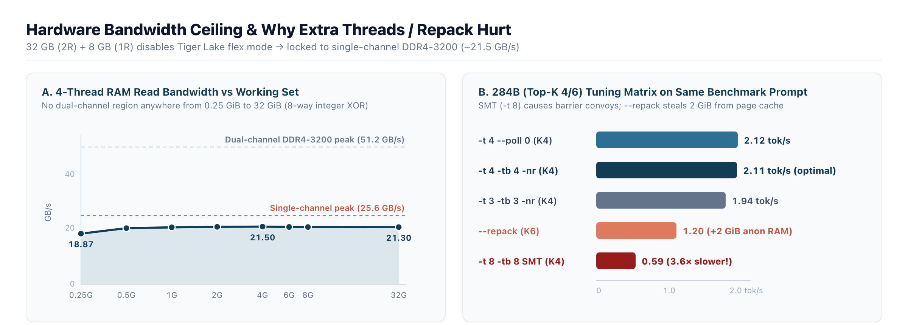
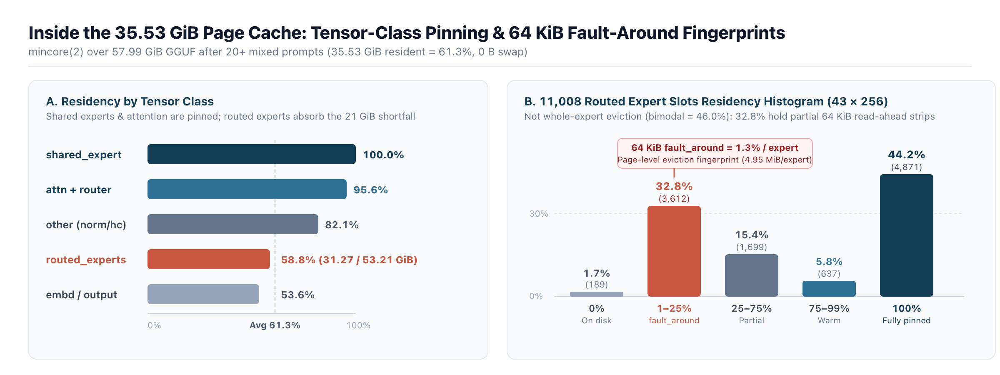
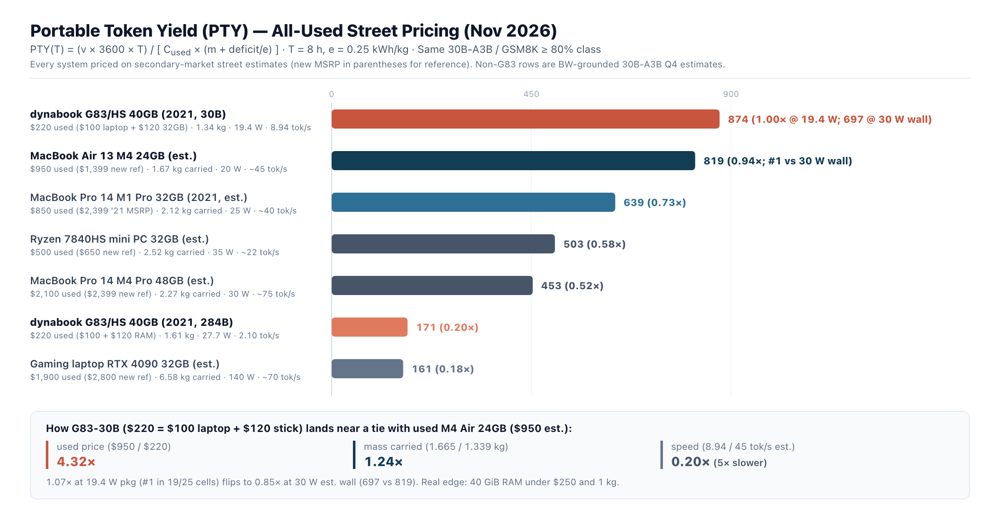

<div align="center">


<br/><br/>

[-133C55?style=flat-square)](./README.md#2-hardware-limits-and-why-dual-channel-didnt-work)
[-2E6F95?style=flat-square)](./README.md#2-hardware-limits-and-why-dual-channel-didnt-work)
[](./README.md#2-hardware-limits-and-why-dual-channel-didnt-work)
[](./README.md#3-how-58-gib-runs-in-38-gib-mincore2-profile)
[](./README.md#1-benchmarks-284b-vs-30b-vs-8b)
[](./LICENSE)

<p>
  <a href="#1-benchmarks-284b-vs-30b-vs-8b">Benchmarks</a> &middot;
  <a href="#2-hardware-limits-and-why-dual-channel-didnt-work">Hardware &amp; Bandwidth</a> &middot;
  <a href="#3-how-58-gib-runs-in-38-gib-mincore2-profile"><code>mincore(2)</code> Profile</a> &middot;
  <a href="#4-what-220-actually-buys-orc-and-pty"><code>OR@C</code> &amp; <code>PTY</code></a> &middot;
  <a href="#5-twelve-measurement-bugs-i-hit">12 Measurement Bugs</a> &middot;
  <a href="#6-reproduce-and-limitations">Reproduce</a>
</p>

</div>

---

I put a `32 GiB` DDR4 SO-DIMM into a used `dynabook G83/HS` (**931 g** on a kitchen scale, `40 GiB` physical RAM from `8 GiB` soldered + `32 GiB` stick, `38 GiB MemTotal` / `37 GiB` available, `0 B` swap; **~\$220** total at late-2026 used prices, ~\$100 for the laptop and ~\$120 for the stick) and tried running a **57.99 GiB**, **284.33B-parameter MoE** (`DeepSeek-V4-Flash-0731 MaxQ-v4`, 1.75 bpw, all 256 experts intact) on it. It runs at **2.10 tok/s** (Top-4) or **1.65 tok/s** (Top-6) without OOMing, swapping, or pruning experts.

Note up front: the engine is [Synchopate's `llama-modchip`](https://github.com/synchopate/llama-modchip) and the weights are his `MaxQ-v4` GGUF, not mine. I benchmarked that stack against two `Q4_K_M` baselines (`Qwen3-30B-A3B` and `Llama-3.1-8B`) to see whether cramming a 58 GiB model into 38 GiB of RAM makes sense once you look at speed, power, and accuracy.

All three models ran on the same binary (`llama-server-modchip` b12416, `-t 4 -tb 4 -c 4096`). Both `284B` (which couldn't spare `2 GiB` of anonymous RAM for repacking) and `8B` ran with `-nr` (`--no-repack`). During the main eval campaign, `30B` ran with default repack (`8.94 tok/s`); a later A/B check showed `-nr` is slightly faster on `30B` as well (`9.47` vs `9.17 tok/s`), so the main tables keep the lower `8.94` figure.

Short version: at Top-4, **84.0% (`4.69` of `5.58 GB`) of the 284B's per-token traffic isn't quantized to 1.75 bits** (`blk.*` dense layers, `203 MB` of 21-layer DSA indexers, shared experts, and `output.weight` stay at `Q4_K`–`Q8_0` / `F32` / `BF16`). A plain dense **8B at `Q4_K_M`** (`4.62 GB/tok`) runs **2.1× faster**, and a resident **30B-A3B** (`1.92 GB/tok`) runs **4.3× faster** with **22× lower TTFT**, **6.0× lower CPU package energy**, and no measurable accuracy drop.

| Metric | 284B @ 1.75 bpw (`MaxQ-v4`) | 30B-A3B @ `Q4_K_M` | Llama-3.1-8B @ `Q4_K_M` |
|---|--:|--:|--:|
| Disk footprint / usable RAM | 57.99 / 37 GiB (**1.57× over**) | 17.28 / 37 GiB (resident) | 4.58 / 37 GiB (resident) |
| Exact bytes / token (`gguf_meta.py`, excl. `token_embd`) | **5.58 GB** (K4) / 6.03 GB (K6) | **1.92 GB** (K8) | **4.62 GB** (dense) |
| Dense blk + output head share | **84.0%** (`4.69 GB`) / 77.8% (K6) | 42.8% (`0.82 GB`) | 100.0% (`4.62 GB`) |
| Repack setting (main eval) | `-nr` (no-repack) | repack on (`-nr` A/B: `9.47`) | `-nr` (no-repack) |
| Generation speed (short ctx) | 2.10 tok/s (K4) / 1.65 (K6) | **8.94 tok/s** (`9.47` w/ `-nr`) | 4.46 tok/s (`2.1×` vs 284B) |
| Generation speed (~734 tok ctx) | ~1.7 tok/s | **6.94 tok/s** (`7.18` w/ `-nr`) | 4.10 tok/s |
| Effective bytes/s, DRAM+NVMe (% of `21.5 GB/s`) | 11.7 GB/s (**55%**) | 17.2 GB/s (**80%**; `85%` `-nr`) | **20.6 GB/s** (**96%**) |
| Prefill (~700 tok) | 7.82 tok/s (`90.1 s`) | **35.01 tok/s** (`21.0 s`) | 33.49 tok/s (`21.9 s`) |
| Short-prompt TTFT | ~20.0 s (`20 tok`) | **0.9 s** (`18 tok`) | 1.5 s (`45 tok`) |
| Power / energy (`RAPL package-0` only) | 27.7 W (`13.2 J/tok`) | **19.4 W** (`2.2 J/tok`, `6.0×`) | *not sampled* |
| GSM8K 5-shot (`n=25`) | 80.0% ± 8.2 (K4 &amp; K6) | **88.0% ± 6.6** (`strict 84.0%`) | 60.0% ± 10.0 *(raw floor)* |
| TriviaQA 5-shot (`n=50`, EM / audited) | 52.0% ± 7.1 / 64.0% (`32/50`) | 60.0% ± 7.0 / **72.0%** (`36/50`) | 66.0% ± 6.8 / *—* *(raw floor)* |
| RAM residency (`mincore(2)`) | **61.3%** (`routed 58.8%`) | **100%** | **100%** |

---

## 1. Benchmarks: 284B vs. 30B vs. 8B

<div align="center">
  
</div>

### Where the per-token bytes actually go

I parsed all three GGUF tensor tables with the same rule in [`./scripts/gguf_meta.py`](./scripts/gguf_meta.py): sum every `blk.*` dense tensor, add `output.weight` / `output_norm` / `output_hc_*`, add `routed_experts × top_k / expert_count`, and exclude 1-row lookup tables (`token_embd.weight` and `*_tid2eid.weight`):

```
bytes_per_token = sum(blk_dense) + output_head + sum(routed_experts) * (top_k / n_expert)
```

| Model | On disk | Dense + Head | Routed Experts | Total / tok | Decode tok/s | Eff. bytes/s | % of `21.5 GB/s` bus |
|---|--:|--:|--:|--:|--:|--:|--:|
| `DeepSeek-V4-Flash` 284B (K4, `-nr`) | 57.99 GiB | 4.69 GB (84.0%) | 0.89 GB (16.0%) | **5.58 GB** | 2.10 | 11.7 | **55%** *(50% of 23.5 peak)* |
| `Llama-3.1-8B` @ `Q4_K_M` (`-nr`) | 4.58 GiB | 4.62 GB (100%) | 0 GB | **4.62 GB** | 4.46 | **20.6** | **96%** *(88% of 23.5 peak)* |
| `Qwen3-30B-A3B` @ `Q4_K_M` (`repack`) | 17.28 GiB | 0.82 GB (42.8%) | 1.10 GB (57.2%) | **1.92 GB** | **8.94** | 17.2 | **80%** *(73% of 23.5 peak)* |
| `Qwen3-30B-A3B` @ `Q4_K_M` (`-nr` A/B) | 17.28 GiB | 0.82 GB (42.8%) | 1.10 GB (57.2%) | **1.92 GB** | **9.47** | 18.2 | **85%** *(77% of 23.5 peak)* |

The `1.75 bpw` label mostly covers the routed experts, which are only **16.0%** of Top-4 traffic (`22.2%` at Top-6). Across 43 layers, `DeepSeek-V4-Flash` reads `4.26 GB` of dense block tensors (including `203 MB` of 21-layer `indexer.*` weights) plus `0.43 GB` for `output.weight` (`Q6_K`), totaling **`4.69 GB/tok`**. That dense skeleton alone is slightly larger than the entire per-token read of `Llama-3.1-8B @ Q4_K_M` (`4.62 GB/tok`) and `2.4×` larger than `Qwen3-30B-A3B`'s full per-token budget (`1.92 GB/tok`).

*(Side note on an earlier script bug: skipping `indexer.*` and `output.weight` on MoEs while taking the full `.gguf` file size on 8B falsely gave `4.95 vs 4.92 GB`, which implied `21.94 GB/s` on 8B, above the machine's measured `21.5 GB/s` large-working-set ceiling. Applying one rule to all three models puts 8B at `20.6 / 21.5 GB/s = 96%`.)*

Comparing all three speeds also splits out why `284B` runs `2.12×` slower than `8B` (`2.10` vs `4.46 tok/s`) on only `21%` more bytes (`5.58` vs `4.62 GB`):

- Going from `8B` to `30B-A3B (-nr)` drops bus utilization from `96%` (`20.6 GB/s`) to `85%` (`18.2 GB/s`). Both are `Q4_K_M` and 100% resident in RAM with zero page faults, so that `-11 pp` gap is just the cost of Top-8-of-128 `mul_mat_id` sparse gathers.
- Dropping from `85%` (`30B`) to `55%` (`284B K4`, `46%` at `K6`) stacks three things: sparser routing (Top-4 of 256), a `39%` page-cache shortfall (NVMe major faults), and `IQ1_S` / `IQ2_XXS` LUT decoding. For rough comparison, the engine author's fully resident `9950X` K6 run (`9.05 tok/s` on `~89 GB/s` DDR5) hits `6.03 × 9.05 / 89 = 61%` vs. `46%` here (`-15 pp` from paging).
- Cutting `284B` from Top-6 to Top-4 trims bytes by `7.4%` (`6.03 → 5.58 GB`) while speeding up generation by `26.8%` (`1.65 → 2.10 tok/s`). The extra ~19 pp comes from cutting `mul_mat_id` dispatches by a third and faulting fewer experts.
- First-token latency is the real usability gap: a 20-token prompt takes `~20 s` on `284B` (`~18 s` fixed intercept faulting experts off NVMe plus `0.10 s/tok` marginal prefill; `90.1 s` for 704 tokens), compared to `0.9 s` on `30B` and `1.5 s` on `8B`.

### Accuracy (`n=25` / `n=50`)

All three models ran through `lm-eval 0.4.13` (`5-shot greedy`, `/v1/completions`), reported with `lm-eval`'s Bessel `n-1` standard errors:

| Model | GSM8K 5-shot (`n=25`) | TriviaQA 5-shot EM (`n=50`) | TriviaQA Human Audited (`n=50`) |
|---|--:|--:|--:|
| `284B @ 1.75 bpw` | 80.0 ± 8.2 (`20/25`, K4 &amp; K6) | 52.0 ± 7.1 (`26/50`, K6) | 64.0% (`32/50`) |
| `30B-A3B @ Q4_K_M` | **88.0 ± 6.6** (`22/25`, strict `84.0%`) | 60.0 ± 7.0 (`30/50`) | **72.0%** (`36/50`) |
| `Llama-3.1-8B @ Q4_K_M` *(raw floor)* | 60.0 ± 10.0 (`15/25`) | 66.0 ± 6.8 (`33/50`) | *not audited* |

Only one gap in this table clears 2 standard errors: `30B` over `8B` on GSM8K (`+28 pp`, `2.3 SE`). Every other pair sits between `0.8` and `1.5 SE` (`284B` vs `8B` on GSM8K is `+20 pp` / `1.5 SE`; `30B` vs `284B` is `+8 pp` / `0.8 SE`; `8B` over `284B` on TriviaQA is `+14 pp` / `1.43 SE`).

Looking at the actual outputs rather than just the totals: every GSM8K error from `284B` (`80.0%` identical across Top-4, Top-6, `strict`, and `flexible`) got the intermediate steps right and slipped on the final step (like writing `70` instead of `70,000`, or answering a related quantity instead of what was asked). On TriviaQA, raw EM drops `66.0% → 60.0% → 52.0%` as expert quantization gets heavier, which makes sense if factual recall lives in the routed MLP weights, though `n=50` isn't large enough to prove the slope (`1.43 SE`).

One caveat on the `8B` row: `Llama-3.1-8B-Instruct` ran through raw `/v1/completions` without its chat template, because that's the endpoint `lm-eval`'s `local-completions` backend uses here. Its published chat-templated 5-shot score is higher, so read `60.0%` and `66.0%` as lower bounds. All three models went through the exact same path.

<details>
<summary><strong>TriviaQA 50-sample hand audit &amp; Top-K 6 vs 4 regressions</strong></summary>

1. `284B` (K6) false negatives (`26/50 → 32/50 = 64.0%`): `#04 ' breast cancer'` (gold `cancer`), `#08 ' Nikkei 225'` (gold `Nikkei`), `#21 ' Highway 61'` (gold `61`), `#37 ' “Stars on 45”'` (curly quotes broke EM), `#42 ' Manticore'` (missing article `A/The`), `#43 ' Cyclops'` (singular vs `Cyclopes`). Excluded single-letter `' J'` truncation on `J.G. Ballard` (`#34`).
2. `30B-A3B` (Q4) false negatives (`30/50 → 36/50 = 72.0%`): `#00 ' Ross Bagdasarian Sr'` (real name of `David Seville`), `#08 ' Nikkei 225'`, `#15 ' George H'` (`George H.W. Bush` truncated at `.`; excluding `#15` gives `35/50 = 70.0%`), `#21 ' Highway 61'`, `#33 ' 48 Hrs'` (official title *48 Hrs.* stripped at `.`), `#40 ' The deep sea'` (gold `Underwater`/`Undersea`). Excluded `' H'` (`#02`) and `' J'` (`#34`).
3. Top-K 6 → 4 on `284B` (20-prompt internal suite): coding prompts (LRU cache, SQL second-highest salary) stayed the same, while objective checks dropped `9/9 → 7/9`. Summing the partial products of `1,234 × 5,678` (`96,252 + 740,400 + 6,170,000`) dropped carries even with a 1,200-token cap, ending on `7000000?` instead of `7,006,652`; and *"the second mouse gets the cheese"* translated `"second"` into Japanese as `遅い` (*slow mouse*) instead of `二番目` (*second*).

</details>

---

## 2. Hardware limits and why dual-channel didn't work

<div align="center">
  
</div>

Before loading any models, I measured the machine's bounds with [`./scripts/gate_a/run_gate_a.sh`](./scripts/gate_a/run_gate_a.sh):

- Putting a `32 GiB DDR4-3200 2R` SO-DIMM next to the soldered `8 GiB DDR4-3200 1R` didn't enable Tiger Lake flex-mode interleaving. Across working sets from `0.25 GiB` to `32 GiB`, 4-thread read bandwidth stayed flat at **`18.87–21.50 GB/s`** (~84% of single-channel `25.6 GB/s` peak, with `23.51 GB/s` on small-WS sweeps) and `110.5 ns` random pointer-chasing latency.
- BIOS left all `avx512` extensions (`vnni`, `vpopcntdq`, `vbmi2`, etc.) enabled. Under a 3-minute sustained load on AC power, the CPU held **3.7–3.8 GHz at 66–77 °C** without throttling.
- The Samsung `MZVLQ256HAJD` NVMe hits `2,183.5 MB/s` seq 1M QD8, **`54.9 MB/s` (`14,063 IOPS`)** random 4K QD1 (`392×` slower than RAM), and `462.5 MB/s` (`118,396 IOPS`) random 4K QD32.
- 4 threads already saturate the single memory channel. Turning on SMT (`-t 8`) crashes `284B` speed **3.6×** (`2.11 → 0.59 tok/s`) from barrier convoys, while `--repack` allocates `+2 GiB` of anonymous RAM, pushing `2 GiB` of experts out of page cache on `284B K6` (`1.30 → 1.20 tok/s`) and slightly slowing `30B` vs. `-nr` (`9.17` vs `9.47 tok/s`).

<details>
<summary><strong>Full hardware and engine inventory</strong></summary>

| Component | Measured / Observed Spec |
|---|---|
| Machine | `dynabook G83/HS` (`931 g` weighed on kitchen scale; ~\$220 used total: ~\$100 base `8 GiB` laptop + ~\$120 used `32 GiB` DDR4-3200 SO-DIMM) |
| CPU | Intel Core i5-1135G7 (4C/8T, Tiger Lake-U, `8 MiB` L3, `performance` governor + turbo) |
| Memory | `40 GiB` physical (`32 GiB 2R` SO-DIMM + `8 GiB 1R` soldered, DDR4-3200; `38 GiB MemTotal` / `37 GiB` available), **0 B swap** |
| Storage | Samsung `MZVLQ256HAJD-00000` 256 GB NVMe (`110 GiB` Linux ext4 partition) |
| OS / Kernel | Ubuntu 24.04.5 LTS, kernel `6.8.0-139-generic`, MGLRU `/sys/kernel/mm/lru_gen/enabled = 0x0007`, THP `madvise` |
| Battery | Design capacity `53.13 Wh` (this unit is at `22%` health / `11.64 Wh`; runtime scaled to `53.13 Wh`) |
| Model A | `Synchopate/DeepSeek-V4-Flash-0731-MaxQ-v4-64GB-CPU-GGUF` (`57.99 GiB`, 3 shards: `6 MB` metadata stub + `33.10 GiB` + `24.89 GiB`, 43 layers, 256 routed + 1 shared expert, `1.75 bpw`) |
| Model B | `unsloth/Qwen3-30B-A3B-Instruct-2507-GGUF` (`Qwen3-30B-A3B-Instruct-2507-Q4_K_M.gguf`, `17.28 GiB`, SHA256 `6c997b8af...`, 48 layers, 128 routed experts, Top-8) |
| Model C | `unsloth/Llama-3.1-8B-Instruct-GGUF` (`Llama-3.1-8B-Instruct-Q4_K_M.gguf`, `4.58 GiB`, dense 32 layers, tokenized via `NousResearch/Meta-Llama-3.1-8B-Instruct`) |
| Binary &amp; Flags | `llama-server-modchip-linux-x86_64-avx512` (b12416), `-c 4096 -np 1 -b 2048 -ub 1024 -fa on -ctk q8_0 -ctv q8_0 -t 4 -tb 4 --jinja` (`284B` &amp; `8B` w/ `-nr`; `30B` main eval w/ default repack, later A/B `-nr`: `9.47 tok/s`) |

</details>

---

## 3. How 58 GiB runs in 38 GiB: `mincore(2)` profile

With `38 GiB MemTotal` (`40 GiB` physical minus firmware/iGPU carve-out, leaving ~39% of the `58 GiB` file out of page cache) and 256 routed experts per layer, uniform routing over 200 tokens would touch $1 - (1 - 4/256)^{200} = 95.7\%$ of experts (`54 GiB` of `58 GiB`), leaving no room for the OS to hold a stable working set. In practice, generating 48 tokens added only **3,009–3,661 major page faults** on top of the `11,416` load faults.

After 20+ mixed prompts, I ran [`./scripts/inspect_residency.py`](./scripts/inspect_residency.py) (`mmap(PROT_READ, MAP_SHARED)` + `mincore(2)`, a 3-second read-only scan across all `43 × 256 = 11,008` expert slots):

<div align="center">
  
</div>

<br/>

<div align="center">
  
</div>

### What `mincore(2)` shows

1. It isn't file-tail recency. Layer-order correlation is `r = -0.153`, and splitting Shards 2 &amp; 3 into 40 sequential chunks gives **74% residency in the front quarter vs. 73% in the back quarter**.
2. It isn't whole-expert eviction either. Only `46.0%` of the 11,008 slots sit at `0%` or `100%` (below a `60%` bimodal cutoff), and expert-ID correlation is `r = 0.053`.
3. Eviction happens at page granularity with strong layer banding. Each expert is `4.95 MiB` (~`1,240` pages), and Linux `fault_around` pulls **`64 KiB` (16 pages = `1.3%`)** per fault. The **`32.8%` spike in the `1–25%` bin** (`3,612` slots) matches experts that got touched briefly and then partially reclaimed page by page. Since every token runs through all 43 layers, the cold mid-band layers (`L32–34`, median residency `0.006–0.092` vs. `1.000` at `L00–02` and `L38–42`) come from differences in per-layer routing entropy or wherever the cyclic LRU reclaim pass last swept.

<details>
<summary><strong>Layer-band breakdown &amp; major fault counts</strong></summary>

| Layer Band | `attn + router` | `shared_expert` | `routed_experts` |
|---|--:|--:|--:|
| `L00–13` | 96.1% | 100.0% | 63.6% |
| `L14–27` | 95.4% | 100.0% | 53.4% |
| `L28–42` | 95.2% | 100.0% | 59.3% |

- Cold CLI load: `82 s`, `65 GB` read, `37.9 GiB` RSS, `11,416` major faults (warm server load: `53 s`).
- Load + 48 tokens: `14,425` major faults (Top-K 4 `-nr`, `+3,009`), `15,077` (Top-K 6 `-nr`, `+3,661`), `17,988` (Top-K 6 `--repack`, `+6,572`).

</details>

---

## 4. What \$220 actually buys: `OR@C` and `PTY`

The `1.75-bit 284B` loses to `4-bit 30B` on every practical metric here. The laptop itself is still an odd piece of hardware: a socketed `32 GiB` DDR4 slot (`40 GiB` total physical RAM), active cooling, and intact AVX-512 at **`931 g`** for **~\$220** all-in (~\$100 for the used `8 GiB` laptop plus ~\$120 for a used `32 GiB` DDR4-3200 SO-DIMM, so in late 2026 the RAM stick costs more than the laptop). Most sub-1 kg laptops solder `8`, `16`, or `24 GiB` (like a `24 GB` M4 Air, which can't hold the 284B's `35.5 GiB` working set in RAM at all).

Two simple ratios describe that without hand-tuned weights or binary gates:

### `OR@C` (how far past physical RAM it runs)

At `GSM8K ≥ 80%` and `≥ 1 tok/s`:

```
OR = 57.99 GiB model / 37 GiB usable RAM = 1.57x        (0.26 GiB of model per dollar at $220)
```

### `PTY` (tokens per dollar per kilogram carried, all-used pricing)

```
PTY(T) = (v * 3600 * T) / [ C_used * (m + deficit/e) ]

v        sustained generation, tok/s        measured (G83) or BW-grounded 30B-A3B Q4 est. (peers)
T        mission duration, hours            scenario (reported at 8 h; swept 2–24 h)
C_used   used street price, USD             Nov 2026 secondary market (new MSRP shown for ref.)
m        device mass, kg                    weighed (G83) or spec
deficit  max(0, P*T - E_internal), kWh      spare battery carried for deficit beyond internal cell
e        Li-ion pack specific energy        physical constant, 0.25 kWh/kg
P        inference power, W                 RAPL package-0 (G83) or whole-kit estimate (peers)
```

Comparing a used laptop against brand-new retail prices isn't fair, so **every system below uses Nov 2026 secondary-market street estimates**, with new MSRP kept in a reference column (including a same-year 2021 `M1 Pro` MacBook Pro). Capability sets the class (`30B-A3B` / `GSM8K ≥ 80%`) instead of multiplying the score:

| Device | Used \$ (New ref) | kg | W | 30B-class tok/s | carried kg | **PTY (used)** | PTY (new ref) |
|---|--:|--:|--:|--:|--:|--:|--:|
| **dynabook G83/HS 40GB (2021) · 30B** *(measured)* | **220** *(~1,500 '21)* | **0.931** | 19.4 | 8.94 | 1.339 | **874** | — |
| MacBook Air 13 M4 24 GB *(est.)* | 950 *(1,399)* | 1.240 | 20.0 | ~45.0 | 1.665 | 819 | 556 |
| MacBook Pro 14 M1 Pro 32 GB (2021) *(est.)* | 850 *(2,399 '21)* | 1.600 | 25.0 | ~40.0 | 2.122 | 639 | 226 |
| Ryzen 7840HS mini PC 32 GB *(est.)* | 500 *(650)* | 1.400 | 35.0 | ~22.0 | 2.520 | 503 | 387 |
| MacBook Pro 14 M4 Pro 48 GB *(est.)* | 2,100 *(2,399)* | 1.600 | 30.0 | ~75.0 | 2.270 | 453 | 397 |
| dynabook G83/HS 40GB (2021) · 284B *(measured)* | 220 *(~1,500 '21)* | 0.931 | 27.7 | 2.10 | 1.605 | 171 | — |
| Gaming laptop RTX 4090 32 GB *(est.)* | 1,900 *(2,800)* | 2.500 | 140.0 | ~70.0 | 6.580 | 161 | 109 |

<div align="center">
  
</div>

Term-by-term breakdown (`G83-30B` at `$220` vs. used `MacBook Air M4 24 GB` and same-year `2021 M1 Pro 32 GB`):

```
vs. MacBook Air M4 24GB ($950 used est.) = 1.07x  (874 vs 819 at 19.4 W pkg; 0.85x at 30 W wall)
  from used price (950/220)              = 4.32x
  from mass       (1.665/1.339 kg)       = 1.24x
  from speed      (8.94/45 tok/s)        = 0.20x  <-- the G83 is ~5x SLOWER

vs. 2021 M1 Pro 32GB ($850 used est.)    = 1.37x  (874 vs 639 at 19.4 W pkg; 1.09x at 30 W wall)
  from used price (850/220)              = 3.86x
  from mass       (2.122/1.339 kg)       = 1.58x
  from speed      (8.94/40 tok/s)        = 0.22x
```

In an earlier draft I priced the rig at \$150 (bare-laptop ballpark without counting the pulled `32 GiB` stick), which gave `PTY 1,282` at `19.4 W`. Counting ~\$100 for the used `8 GiB` laptop plus ~\$120 for a used `32 GB` DDR4-3200 stick at Nov 2026 prices puts the full kit at \$220, right between the two break-even thresholds against a used M4 Air (\$235 at `19.4 W` package power, \$187 at `30 W` estimated whole-system wall power). At `19.4 W` package power, G83 sits at `874` vs `819` (`1.07×` at `8 h`; `#1` in 19 of 25 `(T, e)` scenarios and `#2` in 6 cells at `12–24 h`). At `30 W` whole-system draw (adding DRAM and display), G83 drops to `697` (`0.85×` vs M4 Air at `8 h`, `#1` in 6 cells, `#2` in 11, `#3` in 8; still `1.09×` ahead of 2021 M1 Pro at `8 h`). Because peer rows are estimates on a `1.92 GB/tok` workload, here is what each peer would need just to tie the \$220 G83:

| Tie requires | tok/s | of peak BW | verdict |
|---|--:|--:|---|
| `MacBook Air M4` vs G83 at `30 W` (PTY `697`) | `38.3` | `61%` of `120 GB/s` | inside ceiling (`~45 tok/s` est. wins on whole-system power) |
| `MacBook Air M4` vs G83 at `19.4 W` (PTY `874`) | `48.0` | `77%` | essentially tied with `~45 tok/s` est. (within peer estimate noise) |
| `2021 M1 Pro` vs `19.4 W` (`43.7` / `42%` vs `30 W`) | `54.7` | `53%` of `200 GB/s` | above published `30–45 tok/s` at `19.4 W`; close at `30 W` |
| `M4 Pro` vs `19.4 W` (`115.4` / `81%` vs `30 W`) | `144.7` | `102%` of `273 GB/s` | above ceiling at `19.4 W`; well above `~75 tok/s` est. at `30 W` |

At \$220, `tokens / ($ · kg)` against a used `24 GB` M4 Air is essentially a wash once you add DRAM and display power. What keeps the `dynabook` useful on its own terms is capacity per dollar under 1 kg: `40 GiB` of RAM under \$250, where a `24 GB` MacBook Air can't hold a `35.5 GiB` working set at all.

<details>
<summary><strong>Pricing &amp; bandwidth estimates behind the non-G83 rows</strong></summary>

- Secondary-market &amp; MSRP references (Nov 2026, eBay / Swappa / RefurbMe ranges): `MacBook Air M4 24GB/512GB` ~\$875–\$1,150 used (`$950` mid, `$1,399` retail MSRP; `$1,199` for BTO `256GB`); `2021 MacBook Pro 14 M1 Pro 32GB` ~\$750–\$950 used (`$850` mid, `$2,399` launch MSRP); `Ryzen 7840HS 32GB mini PC` ~\$450–\$550 pre-owned (`$500`, `$650` new); `MacBook Pro 14 M4 Pro 48GB` ~\$1,999–\$2,400 used (`$2,100`, `$2,399` 512GB base MSRP / `$2,799` 1TB); `RTX 4090 gaming laptop 32GB` ~\$1,750–\$2,400 used (`$1,900`, `$2,800` new ref). The `dynabook G83/HS` is discontinued (2021 corporate MSRP was ~\$1,500; ~\$100 used for the `8 GiB` base laptop plus ~\$120 for a Nov 2026 eBay used `1×32 GB DDR4-3200 SO-DIMM` = ~\$220 total).
- Speed &amp; power estimates: only G83 speed (`8.94` / `2.10`), `RAPL package-0` power (`19.4` / `27.7 W`), kitchen-scale mass (`0.931 kg`), and design battery (`53.13 Wh`) were measured on-device. Peer rows are ballpark estimates for `Qwen3-30B-A3B Q4` (`1.92 GB/tok`) based on published memory bandwidth (`~120 GB/s` M4, `~200 GB/s` M1 Pro, `~273 GB/s` M4 Pro, `~65–75 GB/s` DDR5-5600 mini PC) and thermal limits.

</details>

---

## 5. Twelve measurement bugs I hit

Most of the weird numbers I saw early on turned out to be bugs in my own scripts or accounting:

<details open>
<summary><strong>All 12 caught and fixed measurement bugs</strong></summary>

| # | Bug | False Number Produced | Fix |
|--:|---|---|---|
| 1 | Bandwidth loop `s += a[i]` float dependency chain | `11.5 GB/s` (49% of real; measured adder latency) | Switched to 8-way independent integer XOR (`23.5 GB/s`) |
| 2 | `-no-cnv` flag absent in this build | Exited in `0.02 s` | Used `-st` for single-turn CLI |
| 3 | Extrapolated swap cost from random 4K (`55 MB/s`) | Predicted `0.05 tok/s` vs actual `2.1` | Experts are contiguous; `fault_around` reads `64 KiB` |
| 4 | Regex matched explanation paragraph on translation | Flagged valid K6 output as `FAIL` | Checked only the line containing `ネズミ` |
| 5 | Regex missed LaTeX `\frac{1}{6}` | Flagged both K4 &amp; K6 as `FAIL` | Added LaTeX fraction regex |
| 6 | `ARC` 4-choice loglikelihood returned all `-inf` | Fake `0.25` accuracy | `llama-server` ignores `echo=true`; dropped logprob tasks |
| 7 | `pkill -f llama-server` matched my own SSH command | Repeated self-kill | Matched `/proc/$PID/cmdline[0]` basename |
| 8 | Omitted `output.weight` &amp; `indexer.*` on MoEs while taking full-file size (incl. `token_embd`) on dense 8B | `2.89 GB` early estimate, then `4.95 vs 4.92 GB` | Unified `blk + output.weight` rule (`5.58 / 1.92 / 4.62 GB/tok`), excl. 1-row lookups |
| 9 | `kill` matched absolute path while server used relative path | **Three "Qwen3" runs hit the stale 284B server** | Verified `ss -tlnp` PID `/proc/$PID/cmdline` before every run |
| 10 | Fixed `220`-token cap on custom 20-prompt eval | Verbose Qwen3 truncated (`6/9`), concise 284B passed (`9/9`) | Excluded budget-sensitive custom suite from cross-model conclusions |
| 11 | Omitted `--num_fewshot` on TriviaQA (`lm-eval` defaults to 0-shot) | `0.28` (0-shot) compared against `0.60` (5-shot) | Re-ran explicitly with `--num_fewshot 5` (`0.52`) |
| 12 | Priced an earlier draft at \$150 (bare-laptop ballpark, omitting the pulled `32 GiB` SO-DIMM) | Inflated G83 `PTY` to `1,282` | Priced actual kit (~\$100 laptop + ~\$120 used `32 GB` stick = ~\$220 → `PTY` `874` pkg / `697` wall) |

</details>

---

## 6. Reproduce and limitations

All standalone scripts are in [`./scripts/`](./scripts/):

```bash
# 1. Hardware bounds (4-thread RAM sweep, 3-min thermal check, NVMe fio)
bash ./scripts/gate_a/run_gate_a.sh

# 2. Exact per-token traffic from GGUF tensor headers (MoE and dense)
python3 ./scripts/gguf_meta.py /path/to/284B-*.gguf --top-k 4
python3 ./scripts/gguf_meta.py /path/to/Llama-3.1-8B-Instruct-Q4_K_M.gguf

# 3. Non-intrusive mincore(2) 11,008-slot residency profiler + CSV export
python3 ./scripts/inspect_residency.py /path/to/DeepSeek-V4-Flash-*.gguf

# 4. Prefill & generation probe against running llama-server
python3 ./scripts/prefill_probe.py http://127.0.0.1:8080

# 5. Power sampling (RAPL package-0; psys domain unimplemented on this board)
sudo bash ./scripts/power_probe.sh

# 6. 20-prompt internal suite grader (grades ~/eval/k{4,6}/*.json; prompts in ./scripts/eval_set.json)
python3 ./scripts/auto_grade.py [eval_dir]

# 7. Recompute the PTY table, attribution, 25-scenario sweep, and 30 W wall sensitivity
python3 ./scripts/pty.py
```

### Limitations

- `llama-server-modchip` (b12416) ignores `echo=true` and doesn't return prompt `logprobs`, so loglikelihood tasks (`MMLU`, `ARC`, `HellaSwag`, `GPQA`) can't run here.
- `GSM8K` (`n=25`, `±6.6–10.0 pp`) and `TriviaQA` (`n=50`, `±6.8–7.1 pp`) are small samples; only `30B` vs. `8B` on GSM8K clears 2 SE.
- `Llama-3.1-8B-Instruct` ran through `/v1/completions` without its chat template (same path as `284B` and `30B`), so treat its `60%` / `66%` scores as lower bounds.
- RAPL `package-0` (`27.7 W` / `19.4 W`) excludes DRAM and display power (`psys` reads `0.1 W`), so real wall/battery draw is higher (checked via the `30 W` run in `pty.py`).
- `mincore(2)` is a single post-eval warm snapshot with `lru_gen=0x0007`; I haven't run an `lru_gen=0` A/B yet.
- In §4 PTY, only the G83 column is measured; peer speed, price, and power are estimates. Counting ~\$100 for the bare used laptop plus ~\$120 for a used `32 GB` DDR4 stick (\$220 total) puts G83 right between the \$187 and \$235 break-evens against a used M4 Air (`874` vs `819` at `19.4 W` package power, flipping to `697` vs `819` at `30 W` wall draw), so `PTY` is within peer estimation noise and G83's clear niche is `40 GiB` of RAM under \$250 and under 1 kg.
- `284B` and `8B` ran `-nr`, while `30B` ran default repack during the main eval (`8.94 tok/s`). Since `-nr` later measured faster on `30B` (`9.47 tok/s`), the main table slightly understates `30B`.

---

Measurements taken 2026-11-19 and 2026-11-20.

All 7 raw `lm-eval` JSONL files (`1.3 MB`, unedited) are in [`./eval/`](./eval/). Every accuracy number in the main table recomputes from them with standard-library Python; see [`eval/README.md`](./eval/README.md). The hand-audited TriviaQA numbers aren't stored as data because they were 50 strings checked by eye.

Built on [`llama-modchip`](https://github.com/synchopate/llama-modchip) by Synchopate, who also made the `MaxQ-v4` quantization measured here.
