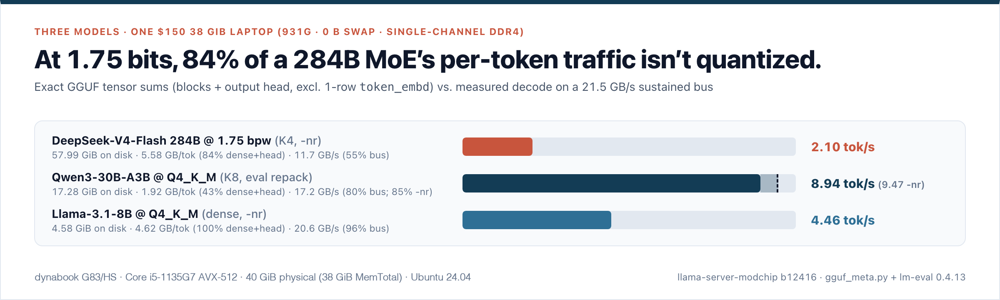

<div align="center">



<br/><br/>

[-133C55?style=flat-square)](./README.md#2-the-hardware-wall--why-dual-channel-failed)
[-2E6F95?style=flat-square)](./README.md#2-the-hardware-wall--why-dual-channel-failed)
[](./README.md#2-the-hardware-wall--why-dual-channel-failed)
[](./README.md#3-how-58-gib-runs-in-38-gib-without-thrashing-mincore2-dissection)
[](./README.md#1-arena-results-284b-vs-30b-vs-8b)
[](./LICENSE)

<p>
  <a href="#1-arena-results-284b-vs-30b-vs-8b">Arena Results</a> &middot;
  <a href="#2-the-hardware-wall--why-dual-channel-failed">Hardware &amp; Bandwidth</a> &middot;
  <a href="#3-how-58-gib-runs-in-38-gib-without-thrashing-mincore2-dissection"><code>mincore(2)</code> Dissection</a> &middot;
  <a href="#4-what-this-150-actually-buys-orc-and-pty"><code>OR@C</code> &amp; <code>PTY</code></a> &middot;
  <a href="#5-eleven-ways-our-benchmarks-lied-to-us">11 Benchmark Traps</a> &middot;
  <a href="#6-reproduce-and-limitations">Reproduce</a>
</p>

</div>

---

A used **\$150** ultraportable laptop (`dynabook G83/HS`, **931 g** on a kitchen scale, `40 GiB` physical RAM (8 GiB soldered + 32 GiB SO-DIMM) / `38 GiB MemTotal` / `37 GiB` available, **0 B swap**) runs a **57.99 GiB**, **284.33B-parameter MoE** (`DeepSeek-V4-Flash-0731 MaxQ-v4`, 1.75 bpw, all 256 experts intact) at **2.10 tok/s** (Top-4) / **1.65 tok/s** (Top-6). No OOM, no swap, no experts dropped.

> **What this is not.** The engine is [Synchopate's `llama-modchip`](https://github.com/synchopate/llama-modchip) and the weights are his `MaxQ-v4` GGUF. Neither is mine. Everything below is measurement of that stack against two `Q4_K_M` baselines (`Qwen3-30B-A3B` and `Llama-3.1-8B`), done to find out where sub-2-bit oversubscription stops being worth the trouble.

All three models ran on the same binary (`llama-server-modchip` b12416, `-t 4 -tb 4 -c 4096`). Both the `284B` (which could not spare `2 GiB` of anonymous RAM for repacking) and the `8B` ran `-nr` (`--no-repack`); the `30B` ran default repack during the main eval campaign (`8.94 tok/s`), and a later A/B check showed `-nr` is also faster on `30B` (`9.47` vs `9.17 tok/s`), so the main tables keep the conservative `8.94` figure.

> [!IMPORTANT]
> **Key Takeaway**: At Top-4, **84.0% (`4.69` of `5.58 GB`) of the `284B` MoE's per-token byte traffic is not quantized to 1.75 bits** (`blk.*` dense layers, `203 MB` of 21-layer DSA indexers, shared experts, and `output.weight` stay at `Q4_K`–`Q8_0` / `F32` / `BF16`). As a result, a plain dense **8B at `Q4_K_M` (`4.62 GB/tok`) runs 2.1× faster**, and a resident **30B-A3B (`1.92 GB/tok`) runs 4.3× faster** with **22× lower TTFT**, **6.0× lower CPU package energy**, and zero measurable accuracy loss.

| Metric | 284B @ 1.75 bpw (`MaxQ-v4`) | 30B-A3B @ `Q4_K_M` | Llama-3.1-8B @ `Q4_K_M` |
|---|--:|--:|--:|
| Disk footprint / usable RAM | 57.99 / 37 GiB (**1.57× over**) | 17.28 / 37 GiB (resident) | 4.58 / 37 GiB (resident) |
| Exact bytes / token (`gguf_meta.py`, excl. `token_embd`) | **5.58 GB** (K4) / 6.03 GB (K6) | **1.92 GB** (K8) | **4.62 GB** (dense) |
| Dense blk + output head share | **84.0%** (`4.69 GB`) / 77.8% (K6) | 42.8% (`0.82 GB`) | 100.0% (`4.62 GB`) |
| Repack setting (main eval) | `-nr` (no-repack) | repack on (`-nr` A/B: `9.47`) | `-nr` (no-repack) |
| Generation speed (short ctx) | 2.10 tok/s (K4) / 1.65 (K6) | **8.94 tok/s** (`9.47` w/ `-nr`) | 4.46 tok/s (`2.1×` vs 284B) |
| Generation speed (~734 tok ctx) | ~1.7 tok/s | **6.94 tok/s** (`7.18` w/ `-nr`) | 4.10 tok/s |
| Effective bytes/s, DRAM+NVMe (% of `21.5 GB/s`) | 11.7 GB/s (**55%**) | 17.2 GB/s (**80%**; `85%` `-nr`) | **20.6 GB/s** (**96%**) |
| Prefill (~700 tok) | 7.82 tok/s (`90.1 s`) | **35.01 tok/s** (`21.0 s`) | 33.49 tok/s (`21.9 s`) |
| Short-prompt TTFT | ~20.0 s (`20 tok`) | **0.9 s** (`18 tok`) | 1.5 s (`45 tok`) |
| Power / energy (`RAPL package-0` only) | 27.7 W (`13.2 J/tok`) | **19.4 W** (`2.2 J/tok`, `6.0×`) | *not sampled* |
| GSM8K 5-shot (`n=25`) | 80.0% ± 8.2 (K4 &amp; K6) | **88.0% ± 6.6** (`strict 84.0%`) | 60.0% ± 10.0 *(raw floor)* |
| TriviaQA 5-shot (`n=50`, EM / audited) | 52.0% ± 7.1 / 64.0% (`32/50`) | 60.0% ± 7.0 / **72.0%** (`36/50`) | 66.0% ± 6.8 / *—* *(raw floor)* |
| RAM residency (`mincore(2)`) | **61.3%** (`routed 58.8%`) | **100%** | **100%** |

---

## 1. Arena Results: 284B vs. 30B vs. 8B

<div align="center">
  
</div>

### Same traffic scale, half the speed: where the bandwidth actually goes

Using a single uniform byte-accounting rule across all three models via [`./scripts/gguf_meta.py`](./scripts/gguf_meta.py) — summing every `blk.*` dense tensor plus `output.weight` / `output_norm` / `output_hc_*`, plus `routed_experts × top_k / expert_count`, while excluding 1-row lookup tables (`token_embd.weight` and `*_tid2eid.weight`):

```
bytes_per_token = sum(blk_dense) + output_head + sum(routed_experts) * (top_k / n_expert)
```

| Model | On disk | Dense + Head | Routed Experts | Total / tok | Decode tok/s | Eff. bytes/s | % of `21.5 GB/s` bus |
|---|--:|--:|--:|--:|--:|--:|--:|
| `DeepSeek-V4-Flash` 284B (K4, `-nr`) | 57.99 GiB | 4.69 GB (84.0%) | 0.89 GB (16.0%) | **5.58 GB** | 2.10 | 11.7 | **55%** *(50% of 23.5 peak)* |
| `Llama-3.1-8B` @ `Q4_K_M` (`-nr`) | 4.58 GiB | 4.62 GB (100%) | 0 GB | **4.62 GB** | 4.46 | **20.6** | **96%** *(88% of 23.5 peak)* |
| `Qwen3-30B-A3B` @ `Q4_K_M` (`repack`) | 17.28 GiB | 0.82 GB (42.8%) | 1.10 GB (57.2%) | **1.92 GB** | **8.94** | 17.2 | **80%** *(73% of 23.5 peak)* |
| `Qwen3-30B-A3B` @ `Q4_K_M` (`-nr` A/B) | 17.28 GiB | 0.82 GB (42.8%) | 1.10 GB (57.2%) | **1.92 GB** | **9.47** | 18.2 | **85%** *(77% of 23.5 peak)* |

Two mechanisms fall straight out of this table:

1. **The `1.75 bpw` headline only quantizes 16% of Top-4 traffic (`22%` at Top-6).**
   Before reading a single routed expert, `DeepSeek-V4-Flash` moves `4.26 GB` of dense block tensors across 43 layers (including `203 MB` of 21-layer `indexer.*` tensors) plus `0.43 GB` for `output.weight` (`Q6_K`) = **`4.69 GB/tok`**. That unquantized skeleton alone exceeds the entire `Llama-3.1-8B @ Q4_K_M` per-token footprint (`4.62 GB/tok`), and is **`2.4×` larger** than `Qwen3-30B-A3B`'s entire per-token total (`1.92 GB`).
   - *Note on an earlier accounting trap*: if `ffn.*` filters miss `indexer.*` and `output.weight` is omitted while `token_embd.weight` (`0.30 GB`) is counted via full-file size on dense models, you falsely get `4.95 vs 4.92 GB` and exceed the machine's measured `21.5 GB/s` large-working-set bandwidth (`4.92 × 4.46 = 21.94 GB/s`). Fixing both ends puts dense 8B cleanly at `20.6 / 21.5 GB/s = 96%`.

2. **Why `8B` beats `284B` by `2.1×` — separating gather, paging, and low-bit decode.**
   `284B` moves `21%` more bytes than `8B` (`5.58` vs `4.62 GB`), yet runs **`2.12×` slower** (`2.10` vs `4.46 tok/s`). Comparing all three isolates the pieces:
   - **Controlled gather penalty (`96% → 85%`, `-11 pp`)**: Both `8B` and `30B-A3B (-nr)` are `Q4_K_M`, 100% RAM-resident, with `0` page faults. Switching from sequential dense `8B` reads to Top-8-of-128 `mul_mat_id` expert gathers drops bus utilization from `96%` (`20.6 GB/s`) to `85%` (`18.2 GB/s`).
   - **Compound penalty on `284B` (`85% → 55%`, `-30 pp`)**: Dropping from `85%` (`30B`) to `55%` (`284B K4`, and `46%` at `K6`) stacks three effects at once: sparser gathers (Top-4 of 256), a `39%` page-cache deficit (NVMe major faults), and `IQ1_S` / `IQ2_XXS` LUT unpacking. For comparison, the engine author's fully resident `9950X` run at K6 (`9.05 tok/s` on `~89 GB/s` DDR5) reaches `6.03 × 9.05 / 89 = 61%` bus efficiency vs. `46%` on this oversubscribed laptop (`-15 pp` from paging).
   - **Top-K 6 → 4 on `284B` (`+26.8%` speed for `-7.4%` bytes)**: Cutting Top-6 to Top-4 drops bytes from `6.03 → 5.58 GB` (`-7.4%`), so the remaining ~19 pp speed gain (`1.65 → 2.10 tok/s`) comes from cutting sparse `mul_mat_id` dispatches by `33%` and trimming fault pressure.
   - **The `22×` TTFT cliff**: A 20-token prompt stalls `~20 s` on `284B` (`~18 s` fixed intercept faulting that batch's experts from NVMe + `0.10 s/tok` marginal prefill; `90.1 s` for 704 tokens) vs. `0.9 s` (`30B`) and `1.5 s` (`8B`).

### Quality & Failure Modes (`n=25` / `n=50`)

All three models on the same two `lm-eval 0.4.13` (`5-shot greedy`, `/v1/completions`) suites (with `lm-eval`'s Bessel `n-1` standard errors):

| Model | GSM8K 5-shot (`n=25`) | TriviaQA 5-shot EM (`n=50`) | TriviaQA Human Audited (`n=50`) |
|---|--:|--:|--:|
| `284B @ 1.75 bpw` | 80.0 ± 8.2 (`20/25`, K4 &amp; K6) | 52.0 ± 7.1 (`26/50`, K6) | 64.0% (`32/50`) |
| `30B-A3B @ Q4_K_M` | **88.0 ± 6.6** (`22/25`, strict `84.0%`) | 60.0 ± 7.0 (`30/50`) | **72.0%** (`36/50`) |
| `Llama-3.1-8B @ Q4_K_M` *(raw floor)* | 60.0 ± 10.0 (`15/25`) | 66.0 ± 6.8 (`33/50`) | *not audited* |

- **Only one pairwise difference clears 2 standard errors**: `30B` over `8B` on GSM8K (`+28 pp`, `2.3 SE`). Every other pair sits at **`0.8–1.5 SE`**: `284B` vs `8B` on GSM8K is `+20 pp` (`1.5 SE`), `30B` vs `284B` is `+8 pp` (`0.8 SE`), and `8B` over `284B` on TriviaQA (`66%` vs `52%`, `+14 pp`, SE `9.8 pp`) is **`1.43 SE`**.
- **Two structural observations (directional, not claimed significant)**:
  - On **GSM8K** (`284B` at `80.0%` identical under Top-4/Top-6 and `strict`/`flexible` extract), every `284B` error got intermediate algebra right and collapsed on the final step (dropping magnitudes like `70` for `70,000` or answering the wrong quantity). Extreme 1.75-bit compression preserves syntax and boilerplate math but degrades final-step precision.
  - On **TriviaQA**, raw EM falls monotonically as expert bit-width shrinks (`66.0% → 60.0% → 52.0%`), consistent with factual recall living in the routed MLP experts, though `n=50` cannot prove the 8B-vs-284B slope (`1.43 SE`).
- **Caveat on the `8B` row**: `Llama-3.1-8B-Instruct` was driven through raw `/v1/completions` without applying its chat template because that is the endpoint `lm-eval`'s `local-completions` backend calls here. Its published 5-shot chat-templated score is higher, so read `60.0%` and `66.0%` strictly as raw-completion floors; all three models used the identical completion path.

<details>
<summary><strong>Deep Dive: Full 50-Sample TriviaQA Audit &amp; Top-K 6 vs 4 Regressions</strong></summary>

1. **284B (K6) false negatives (`26/50 → 32/50 = 64.0%`)**: `#04 ' breast cancer'` (gold `cancer`), `#08 ' Nikkei 225'` (gold `Nikkei`), `#21 ' Highway 61'` (gold `61`), `#37 ' “Stars on 45”'` (curly quotes broke EM), `#42 ' Manticore'` (missing article `A/The`), `#43 ' Cyclops'` (singular vs `Cyclopes`). *Excluded single-letter `' J'` truncation on `J.G. Ballard` (`#34`).*
2. **30B-A3B (Q4) false negatives (`30/50 → 36/50 = 72.0%`)**: `#00 ' Ross Bagdasarian Sr'` (real name of `David Seville`), `#08 ' Nikkei 225'`, `#15 ' George H'` (`George H.W. Bush` truncated at `.`; strictly excluding `#15` yields `35/50 = 70.0%`), `#21 ' Highway 61'`, `#33 ' 48 Hrs'` (official title *48 Hrs.* stripped at `.`), `#40 ' The deep sea'` (gold `Underwater`/`Undersea`). *Excluded `' H'` (`#02`) and `' J'` (`#34`).*
3. **Top-K 6 → 4 on 284B (20-prompt internal suite)**: Coding (LRU cache, SQL second-highest salary) remained identical, while objective checks dropped `9/9 → 7/9`. The multi-digit addition `96,252 + 740,400 + 6,170,000` lost carries even with a 1,200-token budget, ending on `7000000?` instead of `7,006,652`; and *"the second mouse gets the cheese"* translated `"second"` into Japanese as `遅い` (*slow mouse*) instead of `二番目` (*second*).

</details>

---

## 2. The Hardware Wall & Why Dual-Channel Failed

<div align="center">
  
</div>

Measured via [`./scripts/gate_a/run_gate_a.sh`](./scripts/gate_a/run_gate_a.sh) before loading any model:

- **Asymmetric rank lock**: Populating `32 GiB DDR4-3200 2R` alongside the soldered `8 GiB DDR4-3200 1R` did not trigger Intel Tiger Lake flex-mode interleaving. Across working sets from `0.25 GiB` to `32 GiB`, 4-thread read bandwidth stayed flat at **`18.87–21.50 GB/s`** (~84% of single-channel `25.6 GB/s` peak, `23.51 GB/s` at small in-cache/small-WS sweeps) with `110.5 ns` random pointer-chasing latency.
- **Un-fused AVX-512 & zero thermal throttling**: All `avx512` extensions (`vnni`, `vpopcntdq`, `vbmi2`, etc.) are active in BIOS; a 3-minute full load held **3.7–3.8 GHz at 66–77 °C** (AC power).
- **NVMe vs RAM gap (`392×`)**: Samsung `MZVLQ256HAJD` delivers `2,183.5 MB/s` seq 1M QD8, **`54.9 MB/s` (`14,063 IOPS`)** random 4K QD1, and `462.5 MB/s` (`118,396 IOPS`) random 4K QD32.
- **Why `--repack` and `-t 8` fail**: At `4` threads the single memory channel is saturated. Enabling SMT (`-t 8`) crashes speed **3.6×** (`2.11 → 0.59 tok/s`) due to barrier convoys, while `--repack` allocates `+2 GiB` of anonymous RAM—evicting `2 GiB` of experts from page cache on 284B K6 (`1.30 → 1.20 tok/s`) and slightly slowing 30B vs. `-nr` (`9.17` vs `9.47 tok/s`).

<details>
<summary><strong>Hardware &amp; Engine Specifications (Complete Inventory)</strong></summary>

| Component | Exact Measured / Observed Spec |
|---|---|
| Machine | `dynabook G83/HS` (`931 g` weighed on kitchen scale; ~$150 used) |
| CPU | Intel Core i5-1135G7 (4C/8T, Tiger Lake-U, `8 MiB` L3, `performance` governor + turbo) |
| Memory | `40 GiB` physical (`32 GiB 2R` SO-DIMM + `8 GiB 1R` soldered, DDR4-3200; `38 GiB MemTotal` / `37 GiB` available), **0 B swap** |
| Storage | Samsung `MZVLQ256HAJD-00000` 256 GB NVMe (`110 GiB` Linux ext4 partition) |
| OS / Kernel | Ubuntu 24.04.5 LTS, kernel `6.8.0-139-generic`, MGLRU `/sys/kernel/mm/lru_gen/enabled = 0x0007`, THP `madvise` |
| Battery | Design capacity `53.13 Wh` (unit tested at `22%` health / `11.64 Wh`; runtime figures scaled to `53.13 Wh`) |
| Model A | `Synchopate/DeepSeek-V4-Flash-0731-MaxQ-v4-64GB-CPU-GGUF` (`57.99 GiB`, 3 shards: `6 MB` metadata stub + `33.10 GiB` + `24.89 GiB`, 43 layers, 256 routed + 1 shared expert, `1.75 bpw`) |
| Model B | `unsloth/Qwen3-30B-A3B-Instruct-2507-GGUF` (`Qwen3-30B-A3B-Instruct-2507-Q4_K_M.gguf`, `17.28 GiB`, SHA256 `6c997b8af...`, 48 layers, 128 routed experts, Top-8) |
| Model C | `unsloth/Llama-3.1-8B-Instruct-GGUF` (`Llama-3.1-8B-Instruct-Q4_K_M.gguf`, `4.58 GiB`, dense 32 layers, tokenized via `NousResearch/Meta-Llama-3.1-8B-Instruct`) |
| Binary &amp; Flags | `llama-server-modchip-linux-x86_64-avx512` (b12416), `-c 4096 -np 1 -b 2048 -ub 1024 -fa on -ctk q8_0 -ctv q8_0 -t 4 -tb 4 --jinja` (`284B` &amp; `8B` w/ `-nr`; `30B` main eval w/ default repack, later A/B `-nr`: `9.47 tok/s`) |

</details>

---

## 3. How 58 GiB Runs in 38 GiB Without Thrashing: `mincore(2)` Dissection

With a 39% RAM deficit and 256 routed experts per layer, uniform activation over 200 tokens would touch $1 - (1 - 4/256)^{200} = 95.7\%$ of experts (`54 GiB` of `58 GiB`), leaving no working set for the OS to hold. Instead, steady-state generation added only **3,009–3,661 major page faults** over 48 tokens (on top of `11,416` load faults).

Running [`./scripts/inspect_residency.py`](./scripts/inspect_residency.py) (`mmap(PROT_READ, MAP_SHARED)` + `mincore(2)`, 3-second non-intrusive scan across all `43 × 256 = 11,008` expert slots after 20+ mixed prompts) shows what is happening:

<div align="center">
  
</div>

<br/>

<div align="center">
  
</div>

> [!NOTE]
> **Three Diagnostic Verdicts from `mincore(2)`**:
> 1. **Not file-tail recency**: Layer-order correlation is `r = -0.153`, and splitting Shards 2 &amp; 3 into 40 sequential chunks shows **74% (front quarter) vs 73% (back quarter)**.
> 2. **Not whole-expert "zombie" eviction**: Only `46.0%` of the 11,008 slots sit at `0%` or `100%` (`<60%` bimodal threshold), and expert-ID correlation is `r = 0.053`.
> 3. **Page-granularity eviction + layer banding**: Each expert is `4.95 MiB` (~`1,240` pages), and Linux `fault_around` reads **`64 KiB` (16 pages = `1.3%`)** per fault. The **`32.8%` spike in the `1–25%` bin** (`3,612` slots) is the literal footprint of experts sampled briefly and reclaimed at page granularity. Because every token traverses all 43 layers equally, cold mid-band layers (`L32–34`, median residency `0.006–0.092` vs `1.000` at `L00–02` and `L38–42`) reflect differences in per-layer routing concentration (entropy) or the cyclic LRU sweep frontier.

<details>
<summary><strong>Full Layer-Band Breakdown &amp; Fault Counts</strong></summary>

| Layer Band | `attn + router` | `shared_expert` | `routed_experts` |
|---|--:|--:|--:|
| `L00–13` | 96.1% | 100.0% | 63.6% |
| `L14–27` | 95.4% | 100.0% | 53.4% |
| `L28–42` | 95.2% | 100.0% | 59.3% |

- **Cold CLI Load**: `82 s`, `65 GB` read, `37.9 GiB` RSS, `11,416` major faults (Warm server load: `53 s`).
- **Load + 48 tokens**: `14,425` major faults (Top-K 4 `-nr`, `+3,009`), `15,077` (Top-K 6 `-nr`, `+3,661`), `17,988` (Top-K 6 `--repack`, `+6,572`).

</details>

---

## 4. What This \$150 Actually Buys: `OR@C` and `PTY`

`1.75-bit 284B` loses to `4-bit 30B` on everything measurable here. The machine itself is still unusual hardware: a socketed `32 GiB` DDR4 slot, un-fused AVX-512, and active fan cooling at **`931 g`** for **\$150** (most sub-1 kg laptops solder `8` or `16 GiB` and OOM the moment you ask for a `17 GiB` model).

Two simple ratios describe that—neither uses tuned multipliers or binary gates:

### `OR@C` — how far past the memory wall it goes

At `GSM8K ≥ 80%` and `≥ 1 tok/s`:

```
OR = 57.99 GiB model / 37 GiB usable RAM = 1.57x        (0.39 GiB of model per dollar)
```

### `PTY` — tokens per dollar per kilogram carried (all-used pricing)

```
PTY(T) = (v * 3600 * T) / [ C_used * (m + deficit/e) ]

v        sustained generation, tok/s        measured (G83) or BW-grounded 30B-A3B Q4 est. (peers)
T        mission duration, hours            scenario (reported at 8 h; swept 2–24 h)
C_used   used street price, USD             Nov 2026 secondary market (new MSRP shown for ref.)
m        device mass, kg                    weighed (G83) or spec
deficit  max(0, P*T - E_internal), kWh      spare battery carried for deficit beyond internal cell
e        Li-ion pack specific energy        physical constant, 0.25 kWh/kg
P        inference power, W                 RAPL package-0 (G83) or whole-kit estimate (peers)
```

To avoid biasing a \$150 used ultrabook against brand-new retail pricing, **every system below is priced on Nov 2026 secondary-market street estimates**, with new MSRP included alongside as a reference column (including a same-year 2021 `M1 Pro` MacBook Pro). Capability defines the weight class (`30B-A3B` / `GSM8K ≥ 80%`) rather than multiplying the score:

| Device | Used \$ (New ref) | kg | W | 30B-class tok/s | carried kg | **PTY (used)** | PTY (new ref) |
|---|--:|--:|--:|--:|--:|--:|--:|
| **dynabook G83/HS (2021) · 30B** *(measured)* | **150** *(~1,500 '21)* | **0.931** | 19.4 | 8.94 | 1.339 | **1,282** | — |
| MacBook Air 13 M4 24 GB *(est.)* | 950 *(1,399)* | 1.240 | 20.0 | ~45.0 | 1.665 | 819 | 556 |
| MacBook Pro 14 M1 Pro 32 GB (2021) *(est.)* | 850 *(2,399 '21)* | 1.600 | 25.0 | ~40.0 | 2.122 | 639 | 226 |
| Ryzen 7840HS mini PC 32 GB *(est.)* | 500 *(650)* | 1.400 | 35.0 | ~22.0 | 2.520 | 503 | 387 |
| MacBook Pro 14 M4 Pro 48 GB *(est.)* | 2,100 *(2,399)* | 1.600 | 30.0 | ~75.0 | 2.270 | 453 | 397 |
| dynabook G83/HS (2021) · 284B *(measured)* | 150 *(~1,500 '21)* | 0.931 | 27.7 | 2.10 | 1.605 | 251 | — |
| Gaming laptop RTX 4090 32 GB *(est.)* | 1,900 *(2,800)* | 2.500 | 140.0 | ~70.0 | 6.580 | 161 | 109 |

<div align="center">
  
</div>

**Term-by-term decomposition (`G83-30B` vs. used `MacBook Air M4 24 GB` & same-year `2021 M1 Pro 32 GB`):**

```
vs. MacBook Air M4 24GB ($950 used est.) = 1.56x  (1,282 vs 819)
  from used price (950/150)              = 6.33x
  from mass       (1.67/1.34 kg)         = 1.24x
  from speed      (8.94/45 tok/s)        = 0.20x  <-- the G83 is ~5x SLOWER

vs. 2021 M1 Pro 32GB ($850 used est.)    = 2.01x  (1,282 vs 639)
  from used price (850/150)              = 5.67x
  from mass       (2.12/1.34 kg)         = 1.58x
  from speed      (8.94/40 tok/s)        = 0.22x
```

PTY does not claim a 2021 single-channel laptop is fast. It reflects a real depreciation asymmetry: off-lease business ultrabooks with socketed RAM lose ~90% of their original price in 4–5 years, while 24–32 GB Apple Silicon machines hold 35–75% of MSRP on the secondary market. Only the G83 column is measured; peer speed, price and power are all estimates. So it is worth stating what would have to be true for the ranking to flip, in the unit that decides it, the fraction of peak bandwidth a peer must sustain on a `1.92 GB/tok` workload:

| Tie requires | tok/s | of peak BW | verdict |
|---|--:|--:|---|
| `MacBook Air M4` vs G83 at `30 W` (PTY `1,023`) | `56.2` | `90%` of `120 GB/s` | inside the ceiling, breaks if Metal beats `72%` gather efficiency |
| `MacBook Air M4` vs G83 at `19.4 W` (PTY `1,282`) | `70.4` | `113%` | above the ceiling |
| `2021 M1 Pro` | `80.3` | `77%` of `200 GB/s` | below its ceiling, but ~2x its measured `30–45 tok/s` |
| `M4 Pro` | `212` | `149%` of `273 GB/s` | arithmetically out of reach |

The honest reading is narrower than the table's ordering suggests. At G83's measured `19.4 W` package power the M4 Air tie needs `113%` of its bandwidth, which does not exist. At the `30 W` whole-system estimate it needs `90%`, which is high but inside the ceiling, so the M4 Air carries the least margin. It would flip only if Metal sustained `90%` of peak on a sparse gather, against the `72%` that `45 tok/s` already implies. The `2021 M1 Pro` needs a smaller fraction (`77%`) but sits twice its measured `30–45 tok/s`. Only the `M4 Pro` is out of reach under any assumption.

What survives every variant is the `6.3x` used-price gap. The `1.56x` PTY lead does not: at `30 W` the G83 drops to PTY `1,023`, a `1.25x` lead that holds in `23` of `25` `(T, e)` scenarios and loses one at `24 h` on `0.15 kWh/kg` cells.

<details>
<summary><strong>Pricing &amp; Bandwidth Assumptions Behind the Non-G83 Rows</strong></summary>

- **Secondary-market & MSRP references (Nov 2026)**: eBay / Swappa / RefurbMe ranges—`MacBook Air M4 24GB/512GB` ~\$875–\$1,150 used (`$950` mid, `$1,399` retail MSRP; `$1,199` for BTO `256GB`); `2021 MacBook Pro 14 M1 Pro 32GB` ~\$750–\$950 used (`$850` mid, `$2,399` launch MSRP); `Ryzen 7840HS 32GB mini PC` ~\$450–\$550 pre-owned (`$500`, `$650` new); `MacBook Pro 14 M4 Pro 48GB` ~\$1,999–\$2,400 used (`$2,100`, `$2,399` 512GB base MSRP / `$2,799` 1TB); `RTX 4090 gaming laptop 32GB` ~\$1,750–\$2,400 used (`$1,900`, `$2,800` new ref). The `dynabook G83/HS` is discontinued (original 2021 corporate MSRP was ~\$1,500; bought used for `$150`).
- **Speed & power estimates**: Only G83 speed (`8.94` / `2.10`), `RAPL package-0` power (`19.4` / `27.7 W`), kitchen-scale mass (`0.931 kg`), and design battery (`53.13 Wh`) are measured on-device. Every peer row is an order-of-magnitude estimate for a `Qwen3-30B-A3B Q4` (`1.92 GB/tok`) workload grounded in published memory bandwidth (`~120 GB/s` M4, `~200 GB/s` M1 Pro, `~273 GB/s` M4 Pro, `~65–75 GB/s` DDR5-5600 mini PC) and cooling limits.

</details>

---

## 5. Eleven Ways Our Benchmarks Lied to Us

Every surprising anomaly during this project turned out to be a measurement bug until proven otherwise:

<details open>
<summary><strong>Debugging Log: All 11 Caught &amp; Fixed Measurement Bugs</strong></summary>

| # | Bug | False Number Produced | Fix |
|--:|---|---|---|
| 1 | Bandwidth loop `s += a[i]` float dependency chain | `11.5 GB/s` (49% of real) — measured adder latency | Switched to 8-way independent integer XOR (`23.5 GB/s`) |
| 2 | `-no-cnv` flag absent in this build | Exited in `0.02 s` | Used `-st` for single-turn CLI |
| 3 | Extrapolated swap cost from random 4K (`55 MB/s`) | Predicted `0.05 tok/s` vs actual `2.1` | Experts are contiguous; `fault_around` reads `64 KiB` |
| 4 | Regex matched explanation paragraph on translation | Flagged valid K6 output as `FAIL` | Checked only the line containing `ネズミ` |
| 5 | Regex missed LaTeX `\frac{1}{6}` | Flagged both K4 &amp; K6 as `FAIL` | Added LaTeX fraction regex |
| 6 | `ARC` 4-choice loglikelihood returned all `-inf` | Fake `0.25` accuracy | `llama-server` ignores `echo=true`; dropped logprob tasks |
| 7 | `pkill -f llama-server` matched our own SSH command | Repeated self-kill | Matched `/proc/$PID/cmdline[0]` basename |
| 8 | Omitted `output.weight` &amp; `indexer.*` on MoEs while taking full-file size (incl. `token_embd`) on dense 8B | `2.89 GB` early estimate, then `4.95 vs 4.92 GB` | Unified `blk + output.weight` rule (`5.58 / 1.92 / 4.62 GB/tok`), excl. 1-row lookups |
| 9 | `kill` matched absolute path while server used relative path | **Three "Qwen3" runs hit the stale 284B server** | Verified `ss -tlnp` PID `/proc/$PID/cmdline` before every run |
| 10 | Fixed `220`-token cap on custom 20-prompt eval | Verbose Qwen3 truncated (`6/9`), concise 284B passed (`9/9`) | Excluded budget-sensitive custom suite from cross-model conclusions |
| 11 | Omitted `--num_fewshot` on TriviaQA (`lm-eval` defaults to 0-shot) | `0.28` (0-shot) compared against `0.60` (5-shot) | Re-ran explicitly with `--num_fewshot 5` (`0.52`) |

</details>

---

## 6. Reproduce and Limitations

All standalone scripts live in [`./scripts/`](./scripts/):

```bash
# 1. Hardware bounds (4-thread RAM sweep, 3-min thermal check, NVMe fio)
bash ./scripts/gate_a/run_gate_a.sh

# 2. Exact per-token traffic from GGUF tensor headers (MoE and dense)
python3 ./scripts/gguf_meta.py /path/to/284B-*.gguf --top-k 4
python3 ./scripts/gguf_meta.py /path/to/Llama-3.1-8B-Instruct-Q4_K_M.gguf

# 3. Non-intrusive mincore(2) 11,008-slot residency profiler + CSV export
python3 ./scripts/inspect_residency.py /path/to/DeepSeek-V4-Flash-*.gguf

# 4. Prefill & generation probe against running llama-server
python3 ./scripts/prefill_probe.py http://127.0.0.1:8080

# 5. Power sampling (RAPL package-0; psys domain unimplemented on this board)
sudo bash ./scripts/power_probe.sh

# 6. 20-prompt internal suite grader (single-model only, see §5 bug 10)
python3 ./scripts/auto_grade.py            # reads ./scripts/eval_set.json

# 7. Recompute the PTY table, attribution, 25-scenario sweep, and 30 W wall sensitivity
python3 ./scripts/pty.py
```

> [!WARNING]
> **Explicit Limitations**:
> - **No loglikelihood benchmarks**: `llama-server-modchip` (b12416) ignores `echo=true` and does not return prompt `logprobs`, making `MMLU` / `ARC` / `HellaSwag` / `GPQA` untestable here.
> - **Small sample sizes**: `GSM8K (n=25, ±6.6–10.0 pp)` and `TriviaQA (n=50, ±6.8–7.1 pp)` cannot resolve small accuracy differences; only `30B vs 8B` on GSM8K clears 2 SE.
> - **8B chat template**: `Llama-3.1-8B-Instruct` ran through `/v1/completions` without its chat template (same path as 284B/30B); treat its `60%` / `66%` scores as lower bounds.
> - **RAPL domain scope**: `package-0` (`27.7 W` / `19.4 W`) excludes DRAM and display power (`psys` reads `0.1 W`), so wall/battery draw is higher (modeled via the `30 W` sensitivity check in `pty.py`).
> - **Single residency snapshot & no MGLRU A/B**: `mincore(2)` numbers reflect one post-eval warm snapshot (`lru_gen=0x0007`), without an `lru_gen=0` A/B run.
> - **PTY peer rows are estimates**: only the G83 column is measured; peer speed, price and power are all estimates. Break-even in §4 shows the M4 Air and M1 Pro rows are within reach of a tie at whole-system power, so read PTY as "price dominates by ~6x, everything else is a wash" (see §4).
> - **Repack flag asymmetry in main eval**: `284B` and `8B` ran `-nr`; `30B` ran default repack during the main eval (`8.94 tok/s`), and later measured faster with `-nr` (`9.47 tok/s`), so the main table understates `30B` slightly.

---

Measurements taken 2026-11-19 and 2026-11-20.

The raw `lm-eval` samples behind every accuracy number are in [`./eval/`](./eval/), 1.3 MB of
JSONL, unedited. The table recomputes from them in a dozen lines of standard-library Python;
see [`eval/README.md`](./eval/README.md). The hand-audited TriviaQA figures are the one number
that is not stored as data, because the audit was a person reading 50 strings.

Built on [`llama-modchip`](https://github.com/synchopate/llama-modchip) by Synchopate, who also produced the `MaxQ-v4` quantization measured here.
