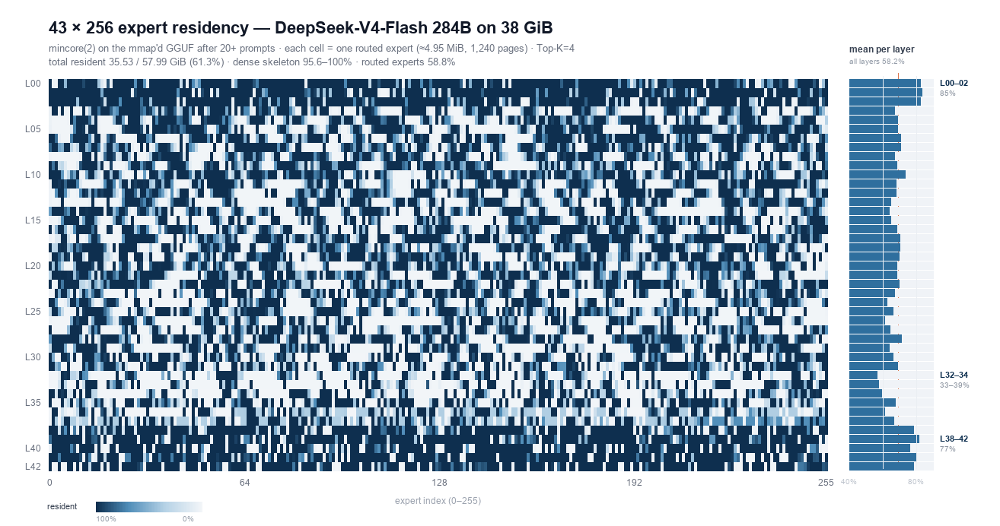

# A 4-bit 30B Beats a 1.75-bit 284B on the Same 38 GB Laptop

> **Hardware**: `dynabook G83/HS` (~$150 used, Intel i5-1135G7 4C/8T, un-fused AVX-512, 38 GiB single-channel DDR4-3200 @ 21.5 GB/s, 256 GB NVMe, **0 B swap**, Ubuntu 24.04.5 LTS / kernel `6.8.0-139`)
> **Engine**: `llama-server-modchip-linux-x86_64-avx512` (build `12416`), identical flags (`-c 4096 -np 1 -b 2048 -ub 1024 -fa on -ctk q8_0 -ctv q8_0 -nr -t 4 -tb 4`)

A ~$150 used ultraportable with 38 GiB of usable RAM can run a **57.99 GiB**, **284.33B-parameter MoE** (`DeepSeek-V4-Flash-0731 MaxQ-v4`, 1.75 bpw, unpruned 256 experts) with **zero swap, zero OOMs, and zero model pruning** at **2.10 tok/s** (Top-4) / **1.65 tok/s** (Top-6).

Then we ran an unpruned **17.28 GiB `Qwen3-30B-A3B-Instruct-2507 @ Q4_K_M`** on the exact same laptop and engine binary:

**It matched or beat the 284B model on accuracy while running 4.3× faster, cutting time-to-first-token by 22×, and using 6× less energy per token.**

| Metric | 284B @ 1.75 bpw (`MaxQ-v4`) | 30B-A3B @ `Q4_K_M` | Delta |
|---|--:|--:|--:|
| Disk footprint / usable RAM | 57.99 / 37 GiB (**1.57× oversubscribed**) | 17.28 / 37 GiB (fully resident) | — |
| Exact bytes moved per token (`gguf_meta.py`) | **4.95 GB** (K4) / 5.40 GB (K6) | **1.66 GB** (K8) | 3.0× |
| Generation speed (short prompt) | 2.10 tok/s (K4) / 1.65 tok/s (K6) | **8.94 tok/s** | **4.3×** |
| Generation speed (~734 tok ctx) | ~1.7 tok/s | **6.94 tok/s** | 4.1× |
| Prefill (~700 tok) | 7.82 tok/s (`90.1 s`) | **35.01 tok/s** (`21.0 s`) | **4.5×** |
| Time-to-first-token (20 tok prompt) | ~20 s | **0.9 s** | **22×** |
| Package power (`RAPL package-0`, excl. DRAM/iGPU) | 27.7 W | **19.4 W** | — |
| Energy per token (`package-0` only) | 13.2 J/tok | **2.2 J/tok** | **6.0×** |
| GSM8K 5-shot (`n=25`) | 80.0% ± 8.2 (K4 & K6) | **88.0% ± 6.6** (`strict 84.0%`) | +8pp (within noise) |
| TriviaQA 5-shot (`n=50`, raw EM) | 52.0% ± 7.1 (`26/50`, K6) | **60.0% ± 7.0** (`30/50`) | +8pp (within noise) |
| TriviaQA 5-shot (`n=50`, human-audited) | 64.0% (`32/50`, K6) | **72.0%** (`36/50`, or `70.0%` excl. `.` cut) | +8pp (+6pp) |
| RAM residency (`mincore(2)`) | **61.3%** (`routed_experts 58.8%`) | **100%** | — |



Three findings came out of this measurement:
1. **Why 58 GiB works in 38 GiB without swap thrashing**: `mincore(2)` across all 11,008 routed expert slots rules out both naive file-tail recency (`r = -0.153`) and whole-expert "zombie" eviction (`bimodal = 46.0%`). Instead, the kernel pins the **dense skeleton (95.6–100% resident)** and leaves **layer-banded expert heat** plus **64 KiB `fault_around` page fragments** (`32.8%` of experts at `1–25%` residency).
2. **Why 1.75-bit 284B loses on speed and energy**: You cannot quantize the dense skeleton (attention, router, shared expert) down to 1.75 bpw. By parsing the GGUF tensors directly (`./scripts/gguf_meta.py`), 43 layers of dense weights alone consume **3,874 MiB (`3.78 GiB` / `4.06 GB`) per token**, pushing total per-token memory traffic to `4.95–5.40 GB` vs `1.66 GB` for `30B`.
3. **Why this `$150` laptop itself is a hardware anomaly**: With a rare open DDR4 SO-DIMM slot in a sub-1 kg chassis (**`931 g` measured**) and un-fused Tiger Lake AVX-512 (`vnni` + `vpopcntdq`), it hits a sweet spot for air-gapped off-grid workloads (`>25 GiB` working set, `>80%` reliability) when running the **4-bit 30B**.

---

## 1. The Hardware Baseline (and Why Dual-Channel Failed)

Measured directly before running models (`./scripts/gate_a/run_gate_a.sh`):

- **CPU**: `i5-1135G7` (4C/8T). Under a 3-minute bandwidth stress test (open lid, AC power, `performance` governor), it held **3.7–3.8 GHz at 66–77 °C** with no sustained thermal throttling (only one transient dip to `2988 MHz`).
- **AVX-512**: `f, bw, dq, vl, cd, ifma, vbmi, vbmi2, bitalg, vnni, vpopcntdq, vp2intersect` — all intact and enabled (many Tiger Lake laptops fuse AVX-512 off in BIOS).
- **RAM**: `38 GiB` usable (`MemTotal`), populated with `32 GB DDR4-3200 2R` (`Controller0-ChannelA-DIMM0`) + `8 GB DDR4-3200 1R` soldered (`Controller1-ChannelA`).
  - Sweeping working set from `0.25 GiB` to `32 GiB` with 4 threads and an 8-way independent integer XOR accumulator (`MAP_POPULATE` pre-faulted) yielded **18.87–23.51 GB/s** (`21.2–21.5 GB/s` from `1 GiB` to `32 GiB`).
  - There is **no dual-channel region**. Mismatched ranks (`2R + 1R`) prevented Intel Tiger Lake flex mode from interleaving across controllers. All runs are bottlenecked at **~21.5 GB/s single-channel DDR4** (`110.5 ns` random 1 GiB pointer-chasing latency).
- **NVMe (`Samsung MZVLQ256HAJD`)**: `2183.5 MB/s` seq 1M QD8, **`54.9 MB/s` (`14,063 IOPS`)** random 4K QD1, `462.5 MB/s` (`118,396 IOPS`) random 4K QD32. RAM bandwidth is **392×** higher than 4K QD1 NVMe reads.
- **Swap**: **0 B** (`/swap.img` removed, `/etc/fstab` disabled) so any memory shortfall manifests directly as clean file-backed `mmap` page faults rather than hidden swap I/O.

### Tuning Matrix on 284B (No Magic Knobs Left)

On the same 300-word prompt (`350` output tokens, Top-K 4 baseline):

| Config | tok/s | Finding |
|---|--:|---|
| `-t 4 -tb 4 -nr` (baseline) | **2.11** | Optimal; saturates the single memory channel |
| `-t 4 --poll 0 --poll-batch 0` | 2.12 | No difference (no core contention at 4 threads) |
| `-t 3 -tb 3` | 1.94 | Slightly under-saturated |
| `-t 8 -tb 8` (SMT enabled) | **0.59** | **3.6× slower**: SMT adds zero memory bandwidth (`23.24` vs `23.51 GB/s`) and hits barrier convoys |
| `--repack` (Top-K 6) | 1.20 | **Negative return**: allocates `+2 GiB` anonymous RAM, evicting `2 GiB` of expert page cache |

---

## 2. How 58 GiB Runs in 38 GiB Without Swap Thrashing: `mincore(2)` Dissection

If every token touched uniformly random experts across 256 routed experts at Top-4, 200 tokens would touch $1 - (1 - 4/256)^{200} = 95.7\%$ of experts—forcing ~21 GiB of cold NVMe reads and collapsing throughput to **0.05 tok/s** (based on `54.9 MB/s` 4K QD1).

Yet actual execution showed:
- **Cold CLI load**: `82 s`, `65 GB` read, `37.9 GiB` peak RSS, `11,416` major page faults.
- **Load + 48 generated tokens**: `14,425` (K4) to `15,077` (K6) total major faults — **only ~3,000–3,700 incremental major faults during generation**.
- **20-prompt cross-domain evaluation**: steady **`1.87–2.25 tok/s` (K4)** and **`1.52–1.82 tok/s` (K6)** across Python, SQL, math, chemistry, and Japanese translation.

To see what actually stayed in the OS page cache without disturbing it, `./scripts/inspect_residency.py` parses GGUF tensor offsets, splits every `ffn_*_exps` tensor `(n_embd, n_ff_exp, 256)` along its slowest-varying expert dimension into `43 × 256 = 11,008` expert slots, and calls Linux `mincore(2)` over a read-only `MAP_SHARED` mapping (taking **3 seconds** after 20+ mixed prompts):

### Residency by Tensor Category

| Category | Resident / Total | Residency | Role |
|---|--:|--:|---|
| `shared_expert` | — | **100.0%** | Read on every token; never evicted |
| `attn + router` | — | **95.6%** | Read on every token (`Q4_K`–`Q8_0` / `BF16`) |
| `embd / output` | — | 53.6% | Single-row lookup per token; low eviction penalty |
| `routed_experts` | `31.27 / 53.21 GiB` | **58.8%** | Absorbs almost the entire 21 GiB shortfall |
| **Total** | **`35.53 / 57.99 GiB`** | **61.3%** | Matches `buff/cache` (~36 GiB) |

### Residency by Layer Depth & 11,008-Slot Histogram

| Layer Band | `attn + router` | `shared_expert` | `routed_experts` |
|---|--:|--:|--:|
| `L00–13` | 96.1% | 100.0% | 63.6% |
| `L14–27` | 95.4% | 100.0% | 53.4% |
| `L28–42` | 95.2% | 100.0% | 59.3% |

- **Hottest layers**: `L00–02` (`85%` mean, median `1.000`) and `L38–42` (`72–83%` mean, median `1.000`).
- **Coldest layers**: `L32–34` (`33–39%` mean, **median `0.006–0.092`** — most experts nearly completely on disk).
- **11,008 Expert Slot Distribution**:
  - `0%` (entirely on disk): `189` (`1.7%`)
  - `1–25%`: **`3,612` (`32.8%`)**
  - `25–75%`: `1,699` (`15.4%`)
  - `75–99%`: `637` (`5.8%`)
  - `100%` (fully resident): `4,871` (`44.2%`)

### What the Diagnostic Checks Prove

1. **Not file-tail recency**: Correlation between layer index and residency is `r = -0.153`. Splitting Shard 2 (`33.10 GiB`) and Shard 3 (`24.89 GiB`) into 40 sequential chunks shows **74% (front quarter) vs 73% (back quarter)**—both ends are equally hot.
2. **Not "zombie" whole-expert eviction**: Only `46.0%` of slots sit at `0%` or `100%` (`<60%` bimodal threshold), and correlation with expert ID is `r = 0.053`.
3. **The `fault_around` fingerprint**: Each routed expert in `DeepSeek-V4-Flash` is `4.95 MiB` (~`1,240` 4 KiB pages). Linux `fault_around` reads **64 KiB (16 pages = `1.3%`)** on a page fault. The **32.8% of slots sitting in the `1–25%` bin** are experts touched once or a few times, leaving behind small `64 KiB` read-ahead strips before page reclaim evicted them—direct evidence of **page-granularity, not expert-granularity, eviction**.
4. **Why `L32–34` are cold while `L00–02` / `L38–42` are pinned**: In a forward pass every token traverses all 43 layers and activates the same number of experts per layer, so total routing counts per layer are identical. The sharp layer contrast points instead to **routing concentration (entropy) per layer** or the **cyclic page-reclaim sweep**: head and tail layers concentrate on a tight subset of experts that stay promoted in LRU, whereas `L32–34` route more diffusely (or sit on the reclaim frontier), leaving only `64 KiB` sampling strips.

---

## 3. Why 1.75-bit 284B Loses to 4-bit 30B

### 3.1 Exact Byte Accounting (`./scripts/gguf_meta.py`)

Naive estimates (`13.17B × 1.75 bpw = 2.89 GB/tok`) get the bandwidth math wrong because dense layers are kept in high precision (`Q4_K`–`Q8_0` / `BF16`). Summing the actual GGUF tensor sizes per layer reveals why `284B` moves **3.0× more bytes per token** than `30B`:

```
bytes_per_token = sum(dense tensors per layer) + sum(all routed experts) * (top_k / n_expert)
```

| Model | Dense Skeleton (per token) | All Routed Experts | Active Routed | **Total / Token** | Measured `tok/s` | Effective BW (`eff`) |
|---|--:|--:|--:|--:|--:|--:|
| `284B @ 1.75 bpw` (`K6`) | `3,874 MiB` (`3.78 GiB`) | `54,484 MiB` | `1,277 MiB` | **5,151 MiB (`5.40 GB`)** | `1.65` | `8.9 GB/s` (`0.41`) |
| `284B @ 1.75 bpw` (`K4`) | `3,874 MiB` (`3.78 GiB`) | `54,484 MiB` | `851 MiB` | **4,725 MiB (`4.95 GB`)** | `2.10` | `10.4 GB/s` (`0.48`) |
| `30B-A3B @ Q4_K_M` (`K8`) | `541 MiB` (`0.53 GiB`) | `16,740 MiB` | `1,046 MiB` | **1,587 MiB (`1.66 GB`)** | **8.94** | **14.8 GB/s (`0.69`)** |

Two consequences follow:
1. **Top-K 6 → 4 speeds up 284B by +26.8% (`1.65 → 2.10 tok/s`) even though bytes/token drop only 9% (`5.40 → 4.95 GB`)** — the extra ~18% gain comes from reducing sparse `mul_mat_id` gather dispatches by 33%.
2. **22× worse interactivity on 284B**: A 20-token prompt takes **`~20 s` TTFT** on `284B` (`18 s` fixed intercept to fault in the batch's active experts + `0.10 s/tok` marginal prefill; `90.1 s` for 704 tokens) vs **`0.9 s` TTFT** on `30B` (`21.0 s` for 734 tokens at `35.01 tok/s`).

### 3.2 Quality & Failure Modes

#### GSM8K (5-shot, `n=25`, `lm-eval 0.4.13`)
- **`284B @ 1.75 bpw`**: **`80.0% ± 8.2`** (`20/25`, identical under both `Top-K 4` and `Top-K 6`, and identical under `strict` and `flexible` extract) — equivalent to `Llama-3-8B` (`79.6%`). All 5 errors show the same pattern: intermediate steps are coherent, then the **final step drops an order of magnitude** (`70` instead of `70000`), answers the wrong quantity (`29` profit diff vs `125`), or mixes fractions with counts (`2/3 - 2 = 0`).
- **`30B-A3B @ Q4_K_M`**: **`88.0% ± 6.6`** (`22/25`; `strict-match 84.0%`).

#### TriviaQA (5-shot, `rc.nocontext`, `n=50`, `generate_until` with `until: ["\n", ".", ","]`)
- **Raw `lm-eval` `exact_match`**: `284B (K6)` = **`52.0% ± 7.1` (`26/50`)** vs `30B (Q4)` = **`60.0% ± 7.0` (`30/50`)**.
- **Line-by-line 50-sample human audit** (checking every zero-scored response for unambiguous synonyms, formatting differences, and period-stop truncations):
  - **Both models lost exactly 6 points (`-12pp`) to string-matching artifacts**:
    - **`284B` false negatives (+6 → `32/50 = 64.0%`)**: `#04` `' breast cancer'` (gold `cancer`), `#08` `' Nikkei 225'` (gold `Nikkei`), `#21` `' Highway 61'` (gold `61`), `#37` `' “Stars on 45”'` (curly quotes), `#42` `' Manticore'` (gold `A/The manticore`), `#43` `' Cyclops'` (gold `Cyclopes`). *(Excluded single-letter `' J'` truncation on `J.G. Ballard` at `#34`.)*
    - **`30B` false negatives (+6 → `36/50 = 72.0%`)**: `#00` `' Ross Bagdasarian Sr'` (real name of `David Seville`), `#08` `' Nikkei 225'`, `#15` `' George H'` (1976–81 CIA Director `George H.W. Bush`, cut at `.`; strictly excluding `#15` yields `35/50 = 70.0%`), `#21` `' Highway 61'`, `#33` `' 48 Hrs'` (actual film title *48 Hrs.* stripped at `.`), `#40` `' The deep sea'` (gold `Underwater`/`Undersea`). *(Excluded `' H'` at `#02` and `' J'` at `#34`.)*
- **Takeaway**: With `±7–8pp` standard error (`n=25/50`), `+8pp` on both GSM8K and TriviaQA is not statistically significant on its own (`~1 SE`), **but 1.75-bit `284B` failed to deliver any measurable accuracy advantage on either math reasoning or long-tail factual recall** while paying 4.3× speed, 22× TTFT, and 6× energy penalties.

#### Top-K 6 vs Top-K 4 Trade-off (20-prompt internal suite)
- Dropping `284B` from trained `Top-K 6` to `Top-K 4` gains **+26.8% speed** (`1.65 → 2.10 tok/s`) and leaves SQL/Python coding intact, but introduces subtle accuracy regressions (`9/9 → 7/9` objective checks): `1234×5678` loses carries even with 1200 tokens (`7000000?`), and *"the second mouse gets the cheese"* translates `"second"` into Japanese as `"遅い"` (*slow mouse*) instead of `"二番目"` (*second*).

---

## 4. Where This `$150`, 40 GB Laptop Actually Wins: `OR@C` and `AHAI`

If `284B` loses on speed, energy, and accuracy, what is the genuine engineering value of this hardware?

1. **Oversubscription Feasibility (`OR@C`)**: At capability `GSM8K ≥ 80%` and sustained `≥ 1 tok/s`, this `$150` laptop hits **`OR@C = 57.99 / 37 = 1.57×`** with zero swap (`0.39 GiB/$`).
2. **Real-World Heavy Off-Grid Terminal (`AHAI`)**: Drop vanity parameter counts completely and model a **real air-gapped field workload**: no network (`α_offline = 1`), battery-only, self-contained screen + keyboard, `≥ 25 GiB` working set (`17.3 GiB` 30B model + `3.5 GiB` context/compute buffers + `4.2 GiB` OS & local dev toolchain), and reliability strictly above the `80%` 8B-smartphone baseline (`ΔOdds = max(0, Acc/(1-Acc) - 4.0)`):

$$\text{AHAI} = \alpha_{\text{offline}} \times \beta_{\text{25G}} \times \frac{\max\left(0,\ \frac{\text{Acc}}{1 - \text{Acc}} - 4.0\right) \times \left(\frac{v_{\text{sustained}} \times T_{\text{battery}} \times 3600}{250\text{ tok/task}}\right)}{W_{\text{terminal (kg)}} \times C_{\text{total (USD)}}}$$

> **Methodology & Estimation Disclosure**: G83 speed, power (`package-0`, excluding DRAM/iGPU), mass (**`931 g` / `0.931 kg` measured on scale**), and GSM8K are measured on-device. G83 battery runtime (`2.74 h`, `~87,000 tok`) is scaled to its `53.13 Wh` design capacity (our used unit's battery is degraded to 22% / `11.64 Wh`). Competitor columns are order-of-magnitude estimates from published specs.

| Platform & Model | $\alpha$ | $\beta_{\text{25G}}$ | $\Delta\text{Odds}$ | Sustained $v$ | Battery (tasks/charge) | Mass × Price (`kg·$`) | **AHAI** | Why |
|---|:-:|:-:|--:|--:|--:|--:|--:|---|
| **`40GB G83/HS + 30B-A3B (Q4)`** *(measured)* | **1** | **1.00** | **+3.33** | **8.82–8.94 t/s** | **2.74 h** (`348`) | `0.931 × $150 = 139.65` | **8.31** | **#1**: Open DDR4 slot to 38 GiB, un-fused AVX-512, active fan (0 throttling) |
| `MacBook Air 13" M3 (24GB) + 30B` *(est.)* | 1 | 0.84 | +3.33 | ~20.0 t/s | ~3.50 h (`1,008`) | `1.24 × $1200 = 1,488` | **1.90** | 8× cost, fanless throttling, 24 GB tight with local dev tools |
| `24GB Android Phone + Folding KB + 30B` *(est.)* | 1 | 0.70 | +3.33 | ~3.8 t/s | ~3.45 h (`189`) | `0.45 × $530 = 238.5` | **1.85** | Fanless 45 °C throttling under sustained load; `lmkd` risk |
| `MacBook Pro 16" M3 Max (64GB) + 30B` *(est.)* | 1 | 1.00 | +3.33 | ~55.0 t/s | ~2.50 h (`1,980`) | `2.15 × $3000 = 6,450` | **1.02** | `46.2×` larger `kg·$` denominator |
| `Mini PC (32GB) + PowerBank/Screen/KB` *(est.)* | 1 | 1.00 | +3.33 | ~15.0 t/s | ~2.20 h (`475`) | `2.30 × $900 = 2,070` | **0.77** | Needs external battery + display + KB (~2.3 kg total) |
| `Gaming Laptop (32GB + 6GB dGPU) + 30B` *(est.)* | 1 | 1.00 | +3.33 | ~14.0 t/s | ~1.45 h (`292`) | `2.58 × $700 = 1,806` | **0.54** | 6 GB VRAM overflows; high off-grid wattage kills battery |
| `40GB G83/HS + 284B (1.75 bpw)` *(measured)* | 1 | 1.00 | **0** (`80%`) | 2.10 t/s | 1.92 h (`58`) | `139.65` | **0** | Proves 35.5 GiB cache limit (`OR@C=1.57×`), misses `>80%` threshold |
| `Mainstream Phones (iPhone / $150 12G) + 8B` *(est.)* | 1 | 0/1 | **0** (`≤80%`) | ~10.0 t/s | ~2.64 h (`380`) | `0.20 × $150 = 30.0` | **0** | OOM on 30B; 8B hits `≤80%` reliability ceiling |
| `RTX 4090 Desktop / Workstation` *(est.)* | 1 | 0.96 | +3.33 | ~90.0 t/s | **0 h** | `18.0 × $2500 = 45,000` | **0** | No battery (off-grid = 0) |
| `Datacenter / Cloud API` | **0** | — | +15.0 | ~80.0 t/s | — | — | **0** | Air-gapped = 0 |

Most sub-1 kg laptops solder 8–16 GB onto the motherboard (`0` score here). The G83/HS wins because it packs a socketed 32 GB DIMM slot, full AVX-512, and active cooling under 1 kg for `$150`.

---

## 5. Eleven Ways Our Benchmarks Lied to Us

Every anomaly in this project turned out to be a measurement bug until proven otherwise:

| # | Bug | False Number Produced | Fix |
|--:|---|---|---|
| 1 | Bandwidth loop `s += a[i]` float dependency chain | `11.5 GB/s` (49% of real) — measured adder latency | Switched to 8-way independent integer XOR (`23.5 GB/s`) |
| 2 | `-no-cnv` flag absent in this build | Exited in `0.02 s` | Used `-st` for single-turn CLI |
| 3 | Extrapolated swap cost from random 4K (`55 MB/s`) | Predicted `0.05 tok/s` vs actual `2.1` | Experts are contiguous; `fault_around` reads `64 KiB` |
| 4 | Regex matched explanation paragraph on translation | Flagged valid K6 output as `FAIL` | Checked only the line containing `ネズミ` |
| 5 | Regex missed LaTeX `\frac{1}{6}` | Flagged both K4 & K6 as `FAIL` | Added LaTeX fraction regex |
| 6 | `ARC` 4-choice loglikelihood returned all `-inf` | Fake `0.25` accuracy | `llama-server` ignores `echo=true`; dropped logprob tasks |
| 7 | `pkill -f llama-server` matched our own SSH command | Repeated self-kill | Matched `/proc/$PID/cmdline[0]` basename |
| 8 | Estimated bytes/token via `13.17B × 1.75 bpw` | `2.89 GB/tok` (predicted 30B only `1.44×` faster) | Summed actual GGUF tensors (`4.95` vs `1.66 GB/tok`) |
| 9 | `kill` matched absolute path while server used relative path | **Three "Qwen3" runs actually hit the stale 284B server** | Verified `ss -tlnp` PID `/proc/$PID/cmdline` before every run |
| 10 | Fixed `220`-token cap on custom 20-prompt eval | Verbose Qwen3 truncated (`6/9`), concise 284B passed (`9/9`) | Excluded budget-sensitive custom suite from cross-model comparison |
| 11 | Omitted `--num_fewshot` on TriviaQA (`lm-eval` defaults to 0-shot) | `0.28` (0-shot) compared against `0.60` (5-shot) | Re-ran explicitly with `--num_fewshot 5` (`0.52`) |

---

## 6. Reproducibility & Limitations

All scripts used for hardware bounds, exact GGUF byte accounting, `mincore(2)` slot residency, prefill/power probing, and grading are included in [`./scripts/`](./scripts/):

```bash
# 1. Hardware baseline (RAM bandwidth, thermal stress, NVMe fio)
bash ./scripts/gate_a/run_gate_a.sh

# 2. Exact per-token bytes from GGUF metadata (works with first 8 MB or full shards)
python3 ./scripts/gguf_meta.py /path/to/*.gguf

# 3. 11,008-slot mincore(2) residency map (outputs CSV for heatmap)
python3 ./scripts/inspect_residency.py /path/to/DeepSeek-V4-Flash-*.gguf

# 4. Prefill & generation probe against running llama-server
python3 ./scripts/prefill_probe.py http://127.0.0.1:8080

# 5. Power measurement (RAPL package-0; psys unimplemented on this board)
sudo bash ./scripts/power_probe.sh
```

**Explicit limitations**:
- **Logprob tasks unsupported**: `llama-server-modchip` (b12416) does not return prompt `logprobs` (`echo=true` ignored), preventing `MMLU` / `ARC` / `HellaSwag` / `GPQA` evaluation.
- **Small benchmark samples**: `GSM8K (n=25, ±8.2pp)` and `TriviaQA (n=50, ±7.1pp)` show direction and magnitude, not fine-grained leaderboard precision.
- **RAPL scope**: `package-0` (`27.7 W` / `19.4 W`) excludes DRAM and platform power (`psys` reads `0.1 W`), so total wall/battery draw is higher.
- **Single-snapshot residency**: `mincore` figures are from one full post-eval warm snapshot; repeated snapshot variance was not measured.
